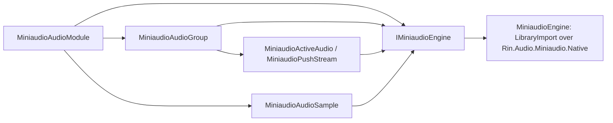

# Rin.Audio.Miniaudio

The miniaudio audio backend: `MiniaudioAudioModule` implements `IAudioModule` from Rin.Core over the native library in the `TareHimself.Rin.Audio.Miniaudio.Native` package. Package id `TareHimself.Rin.Audio.Miniaudio`.

```
uv run python scripts/pack_native.py Rin.Audio.Miniaudio.Native
dotnet build Engine/Rin.Audio.Miniaudio/Rin.Audio.Miniaudio.csproj
```

The first command packs the native package into the local `.feed/` folder the build restores from (leave the module name out to pack every module). Tests live in [Rin.Audio.Miniaudio.Tests](../Rin.Audio.Miniaudio.Tests/ReadMe.md).



`MiniaudioEngine` is the only type that calls the native library, one export per method. Exports that create something return an `AudioResult`, and the engine throws `NativeException` with the export's name and the code instead of handing back a zero handle. The types above it hold handles and bookkeeping only (disposal, effect controllers, the master group that never disposes) and take an `IMiniaudioEngine`, which is what the tests replace.

References: Rin.Core (project reference in `local_file` mode, the `TareHimself.Rin.Core` package in `online` mode), TareHimself.Rin.Audio.Miniaudio.Native. Used by Examples.Common and the projects under `Experiments/`.
