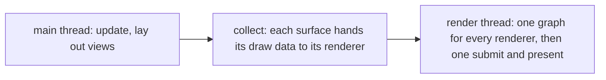

# Rin.Core

The base library: the application loop, the graphics and audio interfaces backends implement, the views (UI) system and shared utilities.

```
dotnet build Engine/Rin.Core/Rin.Core.csproj
dotnet test Engine/Rin.Core.Tests/Rin.Core.Tests.csproj -p:RinShadeSkipCompile=true
```

| Folder | What it is |
| --- | --- |
| root | `Application` (main and render thread loop), `IModule`, `Global` |
| `Graphics/` | Graphics backend interfaces: renderers, the frame graph, resource handles, shaders, windows and input |
| `Views/` | The UI: view tree, layouts, events, MTSDF text, and the shaders that draw it |
| `Audio/` | Audio backend interfaces: samples, groups, channels, push streams, effects |
| `Animation/` | Transitions and sequences for views |
| `Shared/` | Math, buffers, logging, pooling, threading, time, webm video playback |
| `Sources/`, `Content/` | File and embedded resource sources, the default font and texture |

## One frame



The backend ([Rin.Graphics.Vulkan](../Rin.Graphics.Vulkan/ReadMe.md)) owns the graph. Rin.Core holds the interfaces: a pass declares the resources it creates, reads and writes in `Configure`, and records GPU work in `Execute`.

- A graph with no `ITerminalPass` and no write to a `Terminal` resource draws nothing, because those are the pruning roots.
- Register every external image or buffer a pass uses, since order and barriers come from what was declared.

## Views

A `View` is a node in a tree on a `Surface`. Each frame the surface lays the tree out, routes input and collects draw commands. Containers delegate to a layout (list, wrap list, flex, panel, overlay, switcher). Leaf views draw with the `QuadExtensions` helpers (rects, circles, lines, curves, gradients, textures, text) and `AddBlur`.

- Layout is measure then arrange: `GetDesiredSize` (cached) and `View.Layout(available, fill)`. A view fills its slot only when `fill` is true.
- After changing anything that affects size, call `InvalidateDesiredSize()` and `InvalidateLayout()`.
- Layout is in device pixels. There is no DPI scaling.
- Clipping uses the stencil buffer: each distinct clip stack costs a stencil write, and the eighth in a run forces a clear.
- Text is shaped with HarfBuzz and drawn from MTSDF atlases.

The UI shaders are C# under `Views/Graphics/Shaders/`, compiled by [Shade](../../Shade/ReadMe.md).

References: Rin.SourceGenerators, Rin.Shade. Packages: NetVips, StbRectPackSharp, HarfBuzzSharp native assets (called through raw P/Invoke), TareHimself.Rin.Native.
