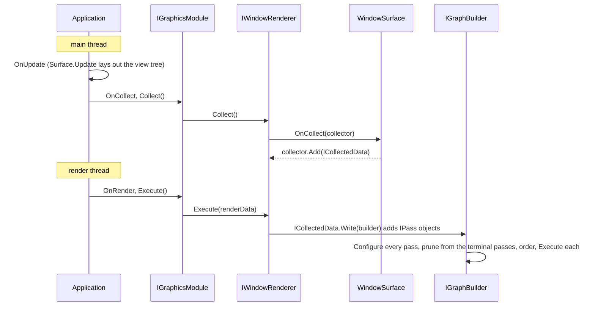
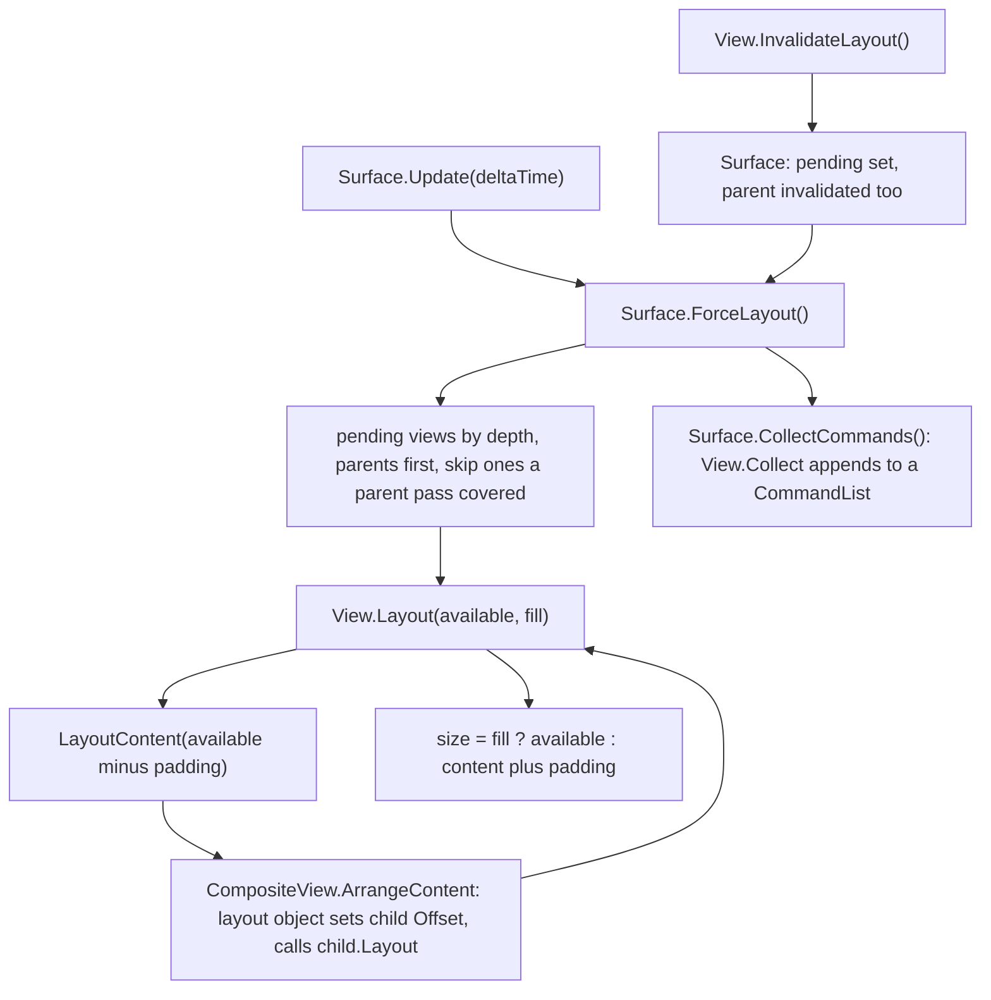
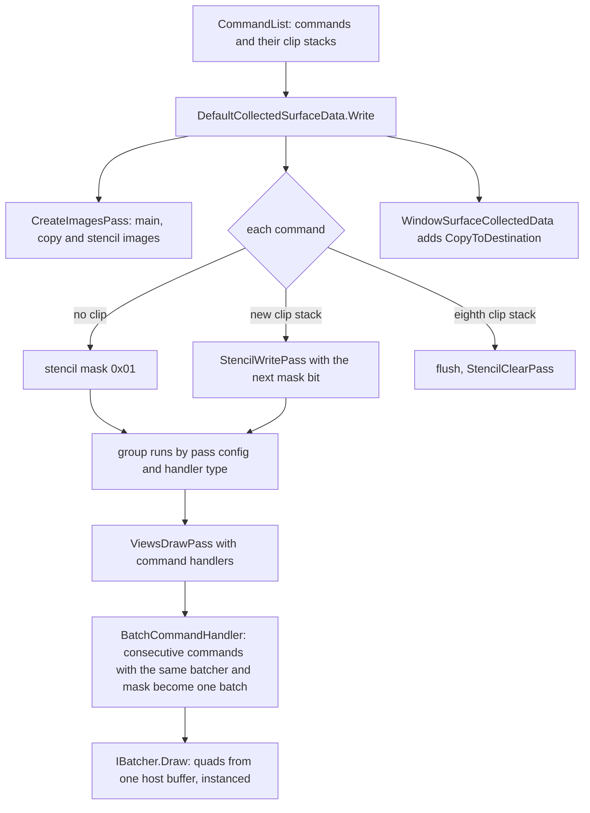

# Rin.Core

The base library of the engine: the application and module model, the graphics and audio interfaces that backends implement, the views (UI) system and shared utilities. Package id `TareHimself.Rin.Core`.

```
dotnet build Engine/Rin.Core/Rin.Core.csproj
dotnet test Engine/Rin.Core.Tests/Rin.Core.Tests.csproj -p:RinShadeSkipCompile=true
```

`-p:RinShadeSkipCompile=true` skips the Rin.Shade compile step, which the tests do not need. The tests are described in [Rin.Core.Tests](../Rin.Core.Tests/ReadMe.md).

| Folder | What it is |
| --- | --- |
| root | `Application` (main and render thread loop, module startup), `IModule`, `Global` (service provider and sources) and the P/Invoke surface of the native library. |
| `Graphics/` | What a graphics backend implements: the module, renderers, the frame graph interfaces, resource handles and bindless data, shader interfaces, windows and input, and a `FrameLimiter` that paces the render thread to a max framerate. |
| `Views/` | The UI system: the view tree, layouts, surface events, fonts and MTSDF text, the command list that becomes render graph passes, and the Rin.Shade shaders that draw it. |
| `Audio/` | What an audio backend implements: the module, samples, groups, channels, push streams and the `[AudioEffect]` effect model. |
| `Animation/` | Transition, delay and sequence animations and the runner views tick them with. |
| `Shared/` | Math, curves, buffers, logging, pooling, providers, threading, time, profiling and webm video playback through the native library from a file, a URL or a pushed stream. |
| `Sources/` | File system and embedded resource sources. `Global.Sources` combines the file system with the embedded `Core` content. |
| `Content/` | Embedded resources: the default font (Noto Sans) and the default texture. |
| `Extensions/`, `Json/` | Extension methods and JSON converters for the `System.Numerics` vectors. |

## One frame



The main thread waits up to 3 ms for the previous render to finish; if it has, it collects and wakes the render thread, otherwise it skips the collect for that tick. The frame graph builder, compiler and executor live in the backend ([Rin.Graphics.Vulkan](../Rin.Graphics.Vulkan/ReadMe.md)); Rin.Core only holds the interfaces.

| Interface | Role |
| --- | --- |
| `IGraphicsModule` | Backend entry point: windows and renderers, shader and resource creation, uploads, `Collect` and `Execute`, max framerate. |
| `IRenderer`, `IWindowRenderer` | `Collect` on the main thread returns the render data `Execute` consumes on the render thread. A window renderer raises `OnCollect` for surfaces. |
| `IGraphCollector`, `ICollectedData` | Subsystems hand collected data to the renderer; `Write` turns it into passes later. |
| `IGraphBuilder`, `IGraphConfig` | Adding passes and external resources; declaring the textures and buffers a pass creates, reads and writes, by `uint` id. |
| `IPass`, `ITerminalPass`, `IPassWithPreAdd`, `IPassWithPostAdd` | `Configure` declares resources, `Execute` records GPU work. Passes nothing terminal depends on are pruned. |
| `ICompiledGraph`, `IExecutionContext` | Resolve ids to resources and record commands during `Execute`. |
| `IGraphicsShader`, `IComputeShader` | Created from a Rin.Shade descriptor; `Bind` returns a context for push constants, buffers and draws, including indirect draws. |
| `IAudioModule`, `IAudioSample`, `IAudioGroup`, `IChannel`, `IPushStream` | Samples and streams play on groups (busses) as channels; a push stream takes PCM pushed from outside. |
| `ISupportsAudioEffects`, `IEffectController<T>` | A group runs `[AudioEffect]` effects in insertion order; the controller's `Parameters` setter hands a new struct to the audio thread through a lock free triple buffer. |

## Views

A `View` is one node of a tree on a `Surface`. Each frame the surface lays the tree out, routes input to it and collects draw commands from it. `ViewsModule` creates one `WindowSurface` per window renderer and loads the default font.



Containers delegate to a layout object under `Views/Layouts/` (list, wrap list, flex, panel, overlay, switcher, root). Leaf views draw with the `QuadExtensions` helpers (rects, circles, lines, curves, gradients, textures, MTSDF text) and `AddBlur`. Text is shaped with HarfBuzz and rendered as MTSDF glyph atlases built on first use each run.



The shaders are C# classes written with Rin.Shade under `Views/Graphics/Shaders/`, marked `[Shader]` and embedded as `<full class name>.crsh` by `msbuild/RinShade.targets`; there are no hand written `.slang` files. Types that shaders in other assemblies need (`ViewShader<T>`, `DeviceHandle`, `BindlessData`, `BorderRadius`, `Int4`, `DrawIndirectCommand`) carry `[ShadeExport]`. The pipeline is described in [Shade](../../Shade/ReadMe.md).

## Rules

| Rule | Why |
| --- | --- |
| A graph with no `ITerminalPass` draws nothing. | Pruning starts from the terminal passes. |
| Register every external image or buffer a pass uses in `Execute`. | The backend derives order and barriers from what was declared. |
| `View.Layout` returns the content size plus padding unless `fill` is true. | A view fills its slot only when the parent asks. |
| The desired size is cached only while the view is on a surface. | Call `InvalidateDesiredSize()` and `InvalidateLayout()` after changing what affects it. |
| Each distinct clip stack costs a stencil write, and the eighth in a run forces a stencil clear. | Seven mask bits are available per run, one is reserved for "no clip". |

References: Rin.SourceGenerators (analyzer), Rin.Shade and its source generator. Packages: NetVips, StbRectPackSharp, HarfBuzzSharp native assets, TareHimself.Rin.Native. Referenced by Rin.World, Rin.Graphics.Vulkan, Rin.Graphics.Null, Rin.Audio.Miniaudio, Rin.Audio.Null, the examples and the experiments.
