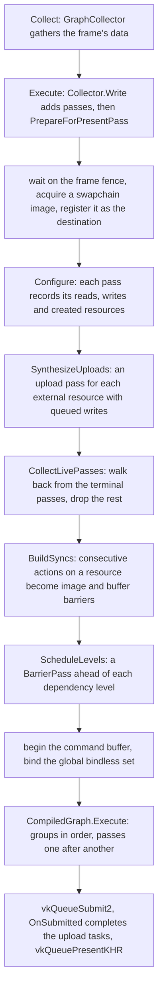

# Rin.Graphics.Vulkan

The Vulkan backend for Rin.Core's `IGraphicsModule`. Package id `TareHimself.Rin.Graphics.Vulkan`. Vulkan calls go through the TerraFX bindings, and the native wrapper `TareHimself.Rin.Graphics.Vulkan.Native` owns instance and device creation, the memory allocator, windows, their events and the clipboard.

```
dotnet build Engine/Rin.Graphics.Vulkan/Rin.Graphics.Vulkan.csproj
```

Restore needs the native package in the local `.feed/`: build it with `uv run python scripts/pack_native.py`, or use the stub packages for build-only work. Both are described in [native/ReadMe.md](../../native/ReadMe.md). Tests live in [Rin.Graphics.Vulkan.Tests](../Rin.Graphics.Vulkan.Tests/ReadMe.md) and run against a NativeAOT fake of the native wrapper, so they need no GPU.

## A frame

The module hooks the application's `OnUpdate`, `OnCollect` and `OnRender` events. `Update` pumps native window events, `Collect` asks every window renderer for its render data, and `Execute` waits on the frame limiter (`SetMaxFramerate`), runs queued `GraphicsSubmit` actions, renders each window and then flushes the queued uploads no graph consumed.



Graph resources are created lazily from a `ResourcePool` keyed by descriptor hash and returned when the frame is done. An external buffer carries its last usage from one graph to the next, so graphs must run in the order they are compiled. A window has one frame in flight by default (`SetFramesInFlight`).

## The native boundary

| Side | Owns |
| --- | --- |
| C# over TerraFX | Swapchains, command buffers, pipelines, descriptor sets, barriers, submits, the render graph and the bindless tables. |
| Native wrapper (`Native.cs`, `LibraryImport` with runtime marshalling disabled) | `createVulkanInstance` (instance, physical device, device, queues, messenger), the memory allocator (`allocator*`), windows and their event pump (`platformWindow*`), drop callbacks, text input and the clipboard. |

No error crosses the boundary as an exception. A native export that can fail returns a `GraphicsResult` code, and the checked wrapper next to its import (`Native.CreateVulkanInstance`, `Native.NewBuffer`, `Native.CreateWindow` and so on) throws a `NativeException` naming the export and the code. The code list lives in `native/Rin.Graphics.Vulkan.Native/src/result.hpp` and is mirrored by `Native.GraphicsResult`.

## Rules you cannot see from one file

| Rule | Why |
| --- | --- |
| The bindless block `rin.global` must be set 0 and share its set with nothing | The engine binds its global descriptor set once per frame at set 0, on the graphics bind point only. `CompiledShaderManager` swaps the shader's reflected layout for the engine's and throws a `ShaderCompileException` otherwise. A compute shader that reads bindless textures binds the set itself with `BindBindlessComputeDescriptors` before its dispatch. |
| Scalar block layout everywhere | The device enables `scalarBlockLayout` and Shade emits `ScalarDataLayout`, so a sequential C# struct and its shader twin share offsets and can be written straight into buffers and push constants. |
| Handles are generational | A `ResourceHandle` carries type, id and generation, and freeing a slot bumps the generation. A stale handle resolves to null (`GetTexture`, `ResolveBuffer`) or throws (`WriteBuffer`). Id 0 is invalid. |
| Uploads are queued, not immediate | `QueueTextureUpload` and `QueueBufferUpload` land in per-resource lanes. A graph that uses the resource consumes them as an upload pass ordered before the first user, the rest are flushed after `Execute` in batches, and the returned task completes after the GPU is done. |
| Shaders are cached by descriptor name | `MakeGraphics` and `MakeCompute` compile the descriptor's shader package on a background queue, and the first descriptor for a name wins. |
| Every `VkResult` is checked | A TerraFX call ends in `.ThrowIfFailed(nameof(...))`, which throws `VulkanException` for a negative result and lets success codes such as `VK_SUBOPTIMAL_KHR` through. `WindowRenderer` turns out-of-date and suboptimal results from acquire and present into a swapchain rebuild instead. |

References: Rin.Core and Rin.Slang (project references in `local_file` mode, the matching NuGet packages in `online` mode). Packages: TareHimself.Rin.Graphics.Vulkan.Native, TerraFX.Interop.Vulkan. Referenced by Examples.Common and the Experiments projects; nothing under `Engine/` references it.
