# Rin.Graphics.Vulkan

The Vulkan backend for Rin.Core's `IGraphicsModule`. Package id `TareHimself.Rin.Graphics.Vulkan`. Vulkan calls go through the TerraFX bindings, and the native wrapper `TareHimself.Rin.Graphics.Vulkan.Native` owns instance and device creation, the memory allocator, windows, their events and the clipboard.

```
dotnet build Engine/Rin.Graphics.Vulkan/Rin.Graphics.Vulkan.csproj
```

Restore needs the native package in the local `.feed/`: build it with `uv run python scripts/pack_native.py`, or use the stub packages for build-only work. Both are described in [native/ReadMe.md](../../native/ReadMe.md). Tests live in [Rin.Graphics.Vulkan.Tests](../Rin.Graphics.Vulkan.Tests/ReadMe.md) and run against a NativeAOT fake of the native wrapper, so they need no GPU.

## A frame

The module hooks the application's `OnUpdate`, `OnCollect` and `OnRender` events. `Update` pumps native window events, `Collect` asks every registered renderer for its render data and hands the batch to the render thread through `FrameCollector` (latest wins, a skipped batch is disposed), and `Execute` waits on the frame limiter (`SetMaxFramerate`), runs queued `GraphicsSubmit` actions, renders the batch into one graph and then flushes the queued uploads no graph consumed.

Every renderer in the batch adds its passes to the same graph. The module owns the frame ring (`Frame`: command buffer, fence, descriptor allocator, `GraphBuilder`), the `ResourcePool` and the global descriptors, and records one submit and one present per frame for every window. A `WindowRenderer` owns only its surface, swapchain and acquire semaphores: `BeginFrame` acquires an image and registers it as a `Terminal` external image, `EndFrame` moves it to `Present` after the graph has recorded, and the module takes its swapchain, image index and semaphores from there.

Renderers register through `AddRenderer` and `RemoveRenderer`. A window's `WindowRenderer` is just a renderer the module creates and registers itself when the window opens, and disposes when the window closes. `RemoveRenderer` waits for the frame in progress, so a renderer may be disposed as soon as it returns, and a batch collected before the removal skips that renderer. `Stop` disposes every renderer still registered, including ones added from outside.

```mermaid
flowchart TD
    A["Collect: each renderer's GraphCollector gathers its data, one batch for the frame"] --> B["Execute: wait on the frame slot's fence, reset it"]
    B --> C["BeginFrame on each renderer: a window rebuilds a dirty swapchain, acquires an image, registers it as a Terminal external image, then Collector.Write adds its passes"]
    C --> D["Configure: each pass records its reads, writes and created resources"]
    D --> E["SynthesizeUploads: an upload pass for each external resource with queued writes"]
    E --> F["CollectLivePasses: walk back from the roots (terminal passes, writers of Terminal resources), drop the rest"]
    F --> G["BuildSyncs: consecutive actions on a resource become image and buffer barriers"]
    G --> H["ScheduleLevels: a BarrierPass ahead of each dependency level"]
    H --> I["begin the command buffer, bind the global bindless set"]
    I --> J["CompiledGraph.Execute: groups in order, passes one after another"]
    J --> K["EndFrame on each renderer that drew: a window moves its swapchain image to Present"]
    K --> L["one vkQueueSubmit2 waiting every acquire semaphore and signalling every render semaphore, OnSubmitted completes the upload tasks"]
    L --> M["one vkQueuePresentKHR with every swapchain, a result per swapchain"]
```



Graph resources are created lazily from a `ResourcePool` keyed by descriptor hash and returned when the frame is done. An external buffer carries its last usage from one graph to the next, so graphs must run in the order they are compiled. The module keeps two frames in flight; a window's `SetFramesInFlight` only sizes its swapchain.

A resize or an out-of-date result marks the swapchain dirty, and the next `BeginFrame` rebuilds it after the frame's own fence wait: the new swapchain is created with `oldSwapchain` set, and the old one, its views, render semaphores and handles are destroyed when that frame slot is next reset, by which point every frame that could reference them has finished, or when the window is disposed, whichever comes first. The device is never waited idle for a rebuild.

## The native boundary

| Side | Owns |
| --- | --- |
| C# over TerraFX | Swapchains, command buffers, pipelines, descriptor sets, barriers, submits, the render graph and the bindless tables. |
| Native wrapper (`Native.cs`, `LibraryImport` with runtime marshalling disabled) | `createVulkanInstance` (instance, physical device, device, queues, messenger), the memory allocator (`allocator*`), windows and their event pump (`platformWindow*`), drop callbacks, text input and the clipboard. |

No error crosses the boundary as an exception. A native export that can fail returns a `GraphicsResult` code, and the checked wrapper next to its import (`Native.CreateVulkanInstance`, `Native.NewBuffer`, `Native.CreateWindow` and so on) throws a `NativeException` naming the export and the code. The code list lives in `native/Rin.Graphics.Vulkan.Native/src/result.hpp` and is mirrored by `Native.GraphicsResult`.

## Rules you cannot see from one file

| Rule | Why |
| --- | --- |
| The bindless block `rin.global` must be set 0 and share its set with nothing | The engine binds its global descriptor set once per frame at set 0, on the graphics bind point only. `CompiledShaderManager` swaps the shader's reflected layout for the engine's and throws a `ShaderCompileException` otherwise. A compute shader that reads bindless textures binds the set itself with `BindBindlessComputeDescriptors` before its dispatch. |
| Scalar block layout everywhere | The device enables `scalarBlockLayout` and Shade emits `ScalarDataLayout`, so a sequential C# struct and its shader twin share offsets and can be written straight into buffers and push constants. |
| Handles are generational | A `ResourceHandle` carries type, id and generation. `ResourceTable<T>` under `Images/` owns the rule: freeing a slot bumps its generation, and the slot's next occupant gets another bump, so a stale handle resolves to null (`GetTexture`, `ResolveBuffer`) or throws (`WriteBuffer`). Id 0 is invalid. |
| Uploads are queued, not immediate | `QueueTextureUpload` and `QueueBufferUpload` land in per-resource lanes. A graph that uses the resource consumes them as an upload pass ordered before the first user. The rest are flushed after `Execute`: `UploadBatch` picks up to 64 writes per kind, drops writes whose resource is gone and sums the staging size with no device involved, then the module records the copies. The returned task completes after the GPU is done. |
| Shaders are cached by descriptor name | `MakeGraphics` and `MakeCompute` compile the descriptor's shader package on a background queue, and the first descriptor for a name wins. |
| Every `VkResult` is checked | A TerraFX call ends in `.ThrowIfFailed(nameof(...))`, which throws `VulkanException` for a negative result and lets success codes such as `VK_SUBOPTIMAL_KHR` through. `WindowRenderer` turns out-of-date and suboptimal results from acquire and present into a swapchain rebuild instead. |

References: Rin.Core and Rin.Slang (project references in `local_file` mode, the matching NuGet packages in `online` mode). Packages: TareHimself.Rin.Graphics.Vulkan.Native, TerraFX.Interop.Vulkan. Referenced by Examples.Common and the Experiments projects; nothing under `Engine/` references it.
