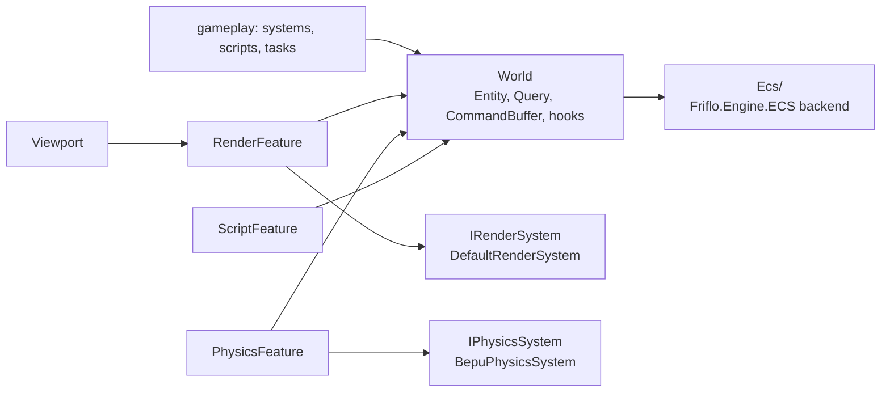
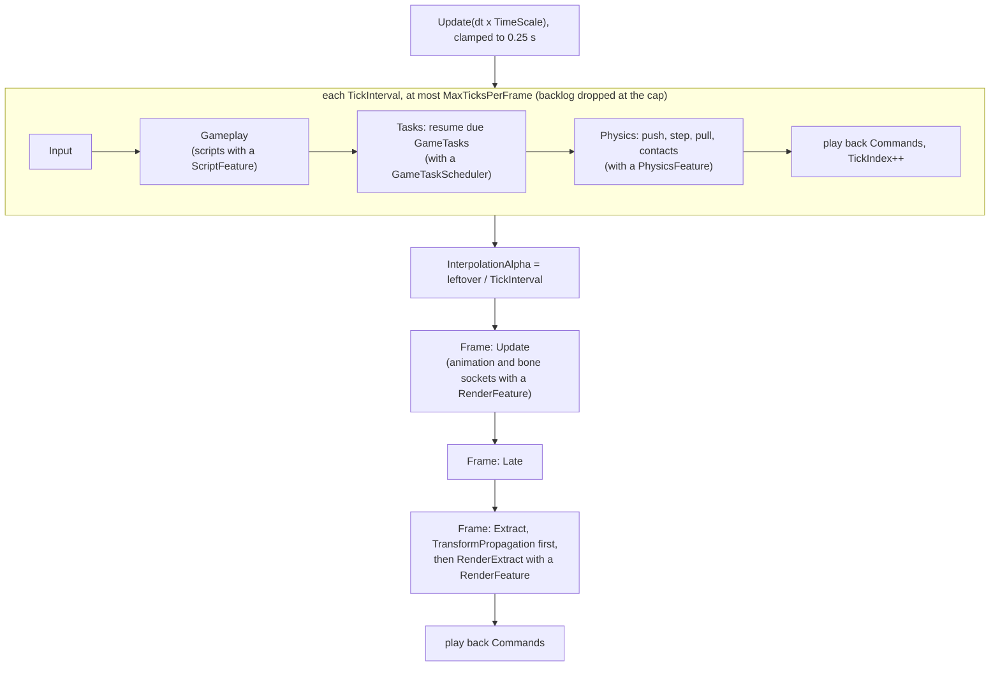
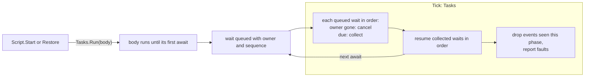
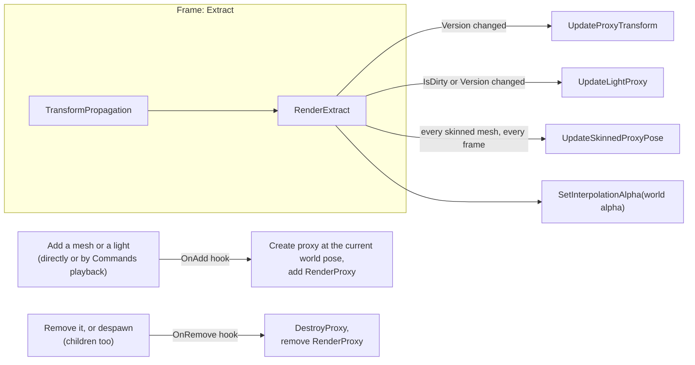
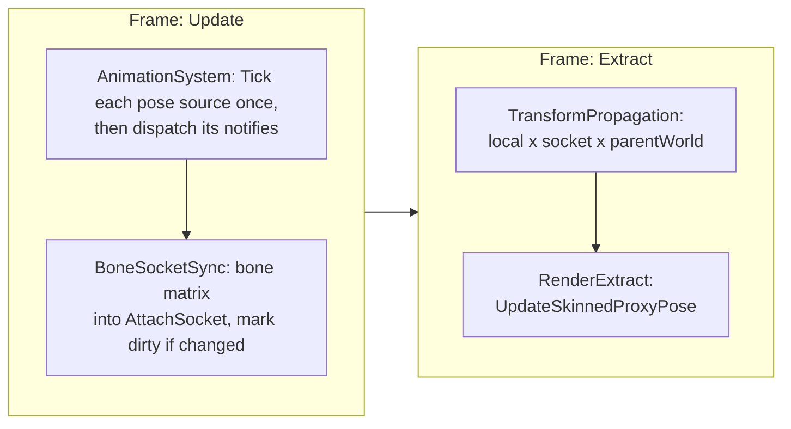
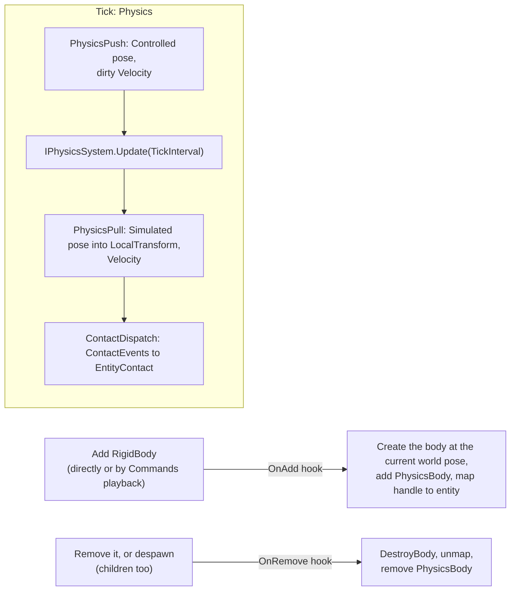
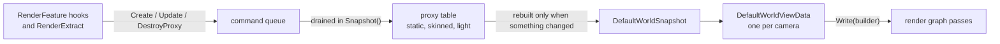

# Rin.World

The scene layer on top of [Rin.Core](../Rin.Core/ReadMe.md). A `World` is an archetype ECS: entities hold plain struct components and ordered systems run on a fixed tick and per frame. Features connect it to the rest of the engine: `RenderFeature` to an `IRenderSystem` (the default deferred pipeline), `PhysicsFeature` to an `IPhysicsSystem` (BepuPhysics) and `ScriptFeature` to scripts and `GameTask`s. `Viewport` shows a world inside a Rin.Core surface.

```
dotnet build Engine/Rin.World/Rin.World.csproj
dotnet test Engine/Rin.World.Tests/Rin.World.Tests.csproj -p:RinShadeSkipCompile=true
```

Without `RinShadeSkipCompile=true` the build also compiles the shaders and needs the real Slang native package. The tests live in [Rin.World.Tests](../Rin.World.Tests/ReadMe.md).



The ECS runs on [Friflo.Engine.ECS](https://github.com/friflo/Friflo.Engine.ECS), but only `Ecs/` may reference Friflo: `BannedSymbols.txt` bans the namespace and `.editorconfig` turns the ban into a build error everywhere else in this project. Gameplay code sees only Rin types, all in `Rin.World` and its subsystem namespaces (`Transforms`, `Scheduling`, `Graphics`, `Physics`, `Animation`, `Scripting`, `Tasks`).

## Entities

| Piece | What it is |
| --- | --- |
| `Entity` | An id plus generation handle. A despawned entity's handle stops matching when the id is reused. |
| `IComponentData`, `ITagData` | Markers for component and tag structs. |
| `Query<T1>` to `Query<T1, T2, T3, T4>` | `foreach (var chunk in query)` gives one `Span<T>` per component and the chunk's entities, without allocating. Structural changes inside the loop throw, so record them in a `CommandBuffer`. |
| `CommandBuffer` | `world.Commands` records spawn, despawn, add, set, remove and tag changes, and applies them in record order. Spawn creates the entity at once so ids follow record order. Commands for an entity that is gone by playback are skipped. |
| Hierarchy | `SetParent`, `ClearParent`, `GetParent`, `GetChildren`. Despawning an entity despawns its descendants, depth first. Reparenting marks the child dirty. |
| Hooks | `OnAdd<T>` fires when a component is new, `OnRemove<T>` fires before it is removed, also on despawn. The features create and destroy proxies and bodies from them. |
| Transforms | `LocalTransform` and `WorldTransform` (matrix plus `Version`). Every `LocalTransform` setter sets its `IsDirty` flag, so a write through a query span needs no structural change. `SetPosition`, `SetRotation`, `SetScale` and `SetLocalTransform` add both components when missing. |

## The update step

`World.Update(dt)` runs fixed ticks of `TickInterval` (1/60 s by default) from the time-scaled delta, then the frame phases. Systems run in the order they were added to their phase.



`TransformPropagation` walks each hierarchy depth first from its roots. It recomputes `world = local x parentWorld` (row vectors), or `local x socket x parentWorld` for an entity with `AttachSocket`, for dirty entities and for children of a parent whose matrix changed, clears `IsDirty`, and bumps `Version` only when the matrix changed. It reaches a subtree only through parents that have both transform components.

## Scripts and tasks

For one-off behaviour that is not worth a system. `new ScriptFeature(world)` adds a Gameplay system that ticks scripts and a `GameTaskScheduler` (`ScriptFeature.Tasks`) whose Tasks system resumes tasks. A scheduler can also be created on its own with `new GameTaskScheduler(world)`.

| Piece | What it does |
| --- | --- |
| `Script` | A managed class attached with `scripts.Attach(entity, script)`, which adds a `ScriptRef` component (a slot in the feature) and calls `Start` right away. `Tick(in TickContext)` runs every tick in attach order, from the first Gameplay phase after the attach. Removing `ScriptRef` (`Detach`) or despawning the entity cancels the script's tasks, then calls `Stop`. One script per entity. Exposes `Entity`, `World` and `Tasks`. |
| `GameTask`, `GameTask<T>` | `async` return types with their own method builders. The method runs synchronously until its first suspension, which rents a pooled node for the state machine. Awaiting anything else (a `Task`, for one) faults the task, so nothing runs on the thread pool. A `GameTask` can be awaited once. |
| `TaskContext` | `Ticks(n)` resumes in the n-th Tasks phase from now (awaited in Gameplay, `NextTick()` resumes in the same tick), `Seconds(s)` is `Ticks` rounded up from `TickInterval`, `Until(condition)` is checked once per Tasks phase, `Event<T>(entity)` takes the first `T` raised with `Raise(entity, value)` after the wait, `WhenAny(a, b)` returns the winner's index and cancels the loser, `WhenAll(a, b)` waits for both. `Run(body)` starts another task. |
| `GameTaskScheduler` | Resumes due waits only in the Tasks phase, in the order they were queued. Every wait has an owner entity (the script's entity for `Script.Tasks`) and one whose owner is gone is cancelled instead of resumed. `Cancel(owner)` and `CancelAll()` cancel by hand. |



| Situation | What happens |
| --- | --- |
| Cancel (owner despawned, script stopped, `WhenAny` loser, `CancelAll`) | The task stops silently: the awaiting method is never resumed, so its `catch` and `finally` blocks do not run. A task awaiting a cancelled task is cancelled too. |
| A task throws | The exception is rethrown at the `await` in the awaiting task. One that escapes a task started with `Run` is reported at the end of the Tasks phase to `GameTaskScheduler.TaskFaulted` with the owner, or rethrown from `Update` when nothing subscribed. The other tasks of the phase still resume. |
| `ScriptFeature.Restore()` | Cancels every task, then calls `Script.Restore` on each script in attach order. Script fields and task locals are never saved, so anything that must survive lives in components and `Restore` restarts the tasks from it. |

At steady state awaiting does not allocate: wait nodes, combinators and state machine nodes come from per-thread pools. The first suspension of a method type allocates its pooled node once, and in a Debug build the compiler allocates every async method's state machine as a class (about 80 bytes per call).

## Rendering

`new RenderFeature(world, renderSystem, meshFactory)` connects a `World` to an `IRenderSystem`. Components hold only unmanaged data: a mesh is its `IMeshFactory` id, and its materials are a `MaterialSet` handle from `RenderFeature.Materials`.

| Component | What it does |
| --- | --- |
| `StaticMesh` | Mesh id plus `MaterialSet`. Surface `i` uses material `i`, a missing one reuses the previous surface's material, an empty set draws the default material. A mesh that is not ready when the component is added gets no proxy. |
| `SkinnedMesh` | Like `StaticMesh`, plus a `PoseSourceHandle` from `RenderFeature.PoseSources`, which supplies the skeleton and the pose. Adding one without a pose source throws. See [Skinning and sockets](#skinning-and-sockets). |
| `PointLight`, `DirectionalLight` | Color, radiance and radius. Every setter sets `IsDirty`, like `LocalTransform`. The directional light shines along the entity's world forward axis. |
| `Camera` | Field of view and clip planes. `world.GetCameraView(entity)` combines it with `WorldTransform` into a `CameraView`. |
| `RenderProxy` | Added by the feature: the proxy handle and the `WorldTransform.Version` last pushed. |

An entity holds at most one of `StaticMesh`, `SkinnedMesh`, `PointLight` and `DirectionalLight` (a second one throws), so use child entities for more.



The proxy starts at the world pose computed from the local transforms, not the stored `WorldTransform`, which is stale until propagation runs. An entity without transforms gets an identity proxy. `RenderExtract` does not allocate.

### Skinning and sockets

Animation is presentation, so it runs per frame on the time-scaled frame delta (`TimeScale` 0 freezes it), not on the fixed tick. Managed pose sources (`IPoseSource`, usually an `AnimationGraph`) live in `RenderFeature.PoseSources`, and `SkinnedMesh` refers to one by handle.



| Piece | What it does |
| --- | --- |
| `AnimationSystem` | Ticks the pose source of every `SkinnedMesh` entity. A source shared by several entities ticks once per frame. Notifies of an `AnimationGraph` fire after the query loop with the world and the entity (`IAnimationNotify.Notify(world, entity, graph)`, `IAnimationNotifyState.NotifyBegin`/`NotifyEnd`), so they may change structure directly, and are then released. |
| `AttachSocket` | Bone index plus the bone's matrix in the parent's space. `renderFeature.AttachToBone(child, parent, "boneName")` resolves the name once, parents the child and adds the socket with the current bone matrix. An unknown bone name throws. Adding or removing the socket marks the child dirty. |
| `BoneSocketSync` | For each socketed child whose parent has a `SkinnedMesh`, copies the bone matrix from the parent's pose. Bone matrices are resolved once per pose change, only when a socket asks. |

The animation, socket and extract systems do not allocate. The pose sources can: `AnimationGraph.Tick` allocates its evaluated pose, about 4.9 KB per tick for a 60 bone clip player.

## Physics

`new PhysicsFeature(world, physicsSystem)` connects a `World` to an `IPhysicsSystem` such as `BepuPhysicsSystem`, the same way `RenderFeature` connects it to the renderer.

| Component | What it does |
| --- | --- |
| `RigidBody` | A `ColliderShape` (box size, sphere radius, or capsule radius plus half height), `PhysicsState`, mass, `IsTrigger` and collision channel. Read once when it is added: overwriting it does not rebuild the body, so remove and add it to change the shape or state. |
| `Velocity` | Linear and angular velocity. Every setter sets `IsDirty` and a dirty velocity is pushed to the body before the next step. Simulated bodies write the stepped velocity back without setting it. |
| `PhysicsBody` | Added by the feature: the body handle and the state it was created with. |

The body is created at the entity's world pose computed from the local transforms (stale `WorldTransform` is not used), including its world scale, which `BepuPhysicsSystem` multiplies into the shape size. The feature maps body handles back to entities with a dense array indexed by the handle, so `FindEntity(handle)` is an array read.



| `PhysicsState` | Push (before the step) | Pull (after the step) |
| --- | --- | --- |
| `Static` | Never moved after creation | Nothing |
| `Controlled` | `SetPosition`, `SetOrientation` from the entity world pose, every tick | Nothing |
| `Simulated` | Only a dirty `Velocity` | Position and rotation into `LocalTransform`, converted into the parent's space for a child (scale untouched), and the velocity |

`WorldTransform` is only propagated per frame, so push and pull compute a child's world pose from the `LocalTransform` chain, one lookup per ancestor. Roots read their local transform directly. Pull writes roots before children so a child converts against its parent's new pose, and writes only values that changed, so a resting body does not dirty propagation.

`PhysicsFeature.Contacts` is a `ReadOnlySpan<EntityContact>` (both entities, begin or end, trigger) of the last step. It is replaced in every tick's `ContactDispatch` and kept until the next one, so gameplay in tick N+1 reads the contacts of tick N, before its own step. A body without an entity shows up as `default`, a contact where neither body has one is dropped, and an entity may have been despawned since the contact.

Queries mirror `IPhysicsSystem`: `RayCast`, `SphereCast`, `BoxCast` and `CapsuleCast` return an `EntityHit` (entity plus the `RayCastResult`), the "all" forms fill a `Span<EntityHit>`, and `OverlapSphere`, `OverlapBox` and `OverlapCapsule` fill a `Span<Entity>`, skipping bodies without an entity. The tick systems and the span queries do not allocate.

Pull writes the stepped pose every tick, `RenderExtract` pushes it once per frame, and the render system blends its previous and current transform by the world's `InterpolationAlpha`, so fixed-step bodies render smoothly.

## From proxies to the GPU

The world never touches GPU state. `RenderFeature` creates, updates and destroys proxies on `IRenderSystem`, and `DefaultRenderSystem` queues every change until the next `Snapshot`.



The snapshot blends each proxy's previous and current transform by the interpolation alpha.

## The default render pipeline

`DefaultWorldViewData.Write` adds the passes. The scene half is shared by every view of the same snapshot in a graph (`GetOrAddShared`), the view half runs once per camera. On a device without indirect rendering, or with `DefaultRenderSystem.DrawMode` set to `Direct`, the culling and command passes are skipped and the depth and G-buffer passes draw each mesh from the CPU instead.

| Pass | Scope | Reads | Writes |
| --- | --- | --- | --- |
| `InitSceneResourcesPass` | scene | | bounds buffer, one `Bounds3D` per surface |
| `SkinningPass` (only with skinned meshes) | scene | source vertices, pose matrices | one shared skinned vertex buffer |
| `BoundsUpdatePass` (only with skinned meshes) | scene | skinned vertices | the skinned entries of the bounds buffer |
| `SceneDataPass` | scene | processed meshes and materials | material data and `IndirectMeshRecord` buffers per batch |
| `InitViewResourcesPass` | view | | GBuffer0..3 (`RGBA32`) and the depth image |
| `CullingPass` | view, indirect only | bounds buffer | one `uint` per surface (always 1 today, nothing is culled yet) |
| `FillIndirectBuffersPass` | view, indirect only | culling results, mesh records | `DrawIndexedIndirectCommand` and draw count buffers per batch |
| `DepthPrepassIndirectPass` or `DepthPrepassDirectPass` | view | indirect commands, depth material data, skinned vertices | depth image |
| `FillGBufferIndirectPass` or `FillGBufferDirectPass` | view | depth image, color material data, textures, skinned vertices | GBuffer0..3 |
| `LightingPass` | view | GBuffer0..3, the light array | the output image (`RGBA16`) |

Meshes are batched by index buffer plus material, so each batch is one `DrawIndexedIndirectCount`. `ShadowPass` exists but is not implemented and nothing adds it.

## Showing a world

`Viewport` (a Rin.Core `ContentView`) takes a `RenderFeature` and a camera entity. It builds the entity's `CameraView` (world matrix plus projection parameters), snapshots the render system with it in `CollectContent`, and `ViewportCommandHandler` writes the pipeline above into the graph and draws the result with `ViewportShader`. A primary click cycles the `ViewportChannel` (scene, each G-buffer channel, radiance), a secondary click captures the mouse for `OnMouseDelta`. The render size follows the content size only after it has been stable for `Viewport.SettleFrames` frames, so a resize stretches the last render instead of reallocating the G-buffers every frame.

`Sponza`, `AssetViewer` and `SceneTest` build a `World` with a `RenderFeature` (`SceneTest` adds a `PhysicsFeature` on `BepuPhysicsSystem`) and give a camera entity a `Viewport`. The `headless` example runs a `World` with only a `PhysicsFeature`.

References: Rin.Core, Rin.Shade (plus its source generator), Rin.SourceGenerators. Packages: BepuPhysics, Friflo.Engine.ECS, Microsoft.CodeAnalysis.BannedApiAnalyzers (build only). Referenced by Rin.GLTF, Examples and Rin.World.Tests.
