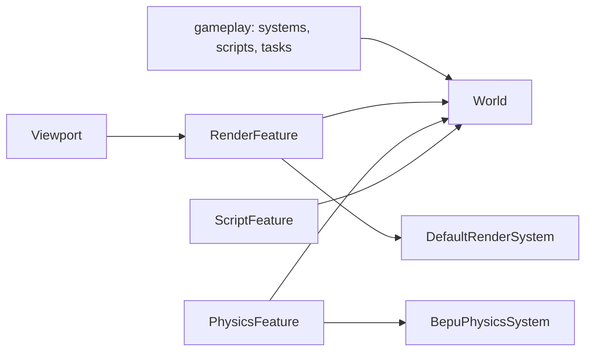
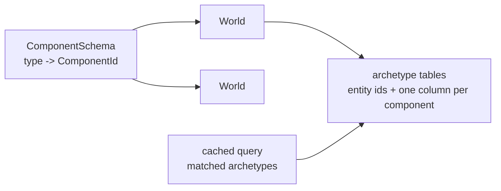

# Rin.World

The scene layer on top of [Rin.Core](../Rin.Core/ReadMe.md): an archetype ECS (`World`) with a fixed tick, plus features that connect it to rendering, physics and scripts.

```
dotnet build Engine/Rin.World/Rin.World.csproj
dotnet test Engine/Rin.World.Tests/Rin.World.Tests.csproj -p:RinShadeSkipCompile=true
```

Without `RinShadeSkipCompile=true` the build also compiles shaders and needs the real Slang native package.



The ECS in `Ecs/` is Rin's own: one table per archetype (component set) with a byte column per component, and queries that cache the archetypes they match.



**Component ids** come from a `ComponentSchema`. `new World()` uses a clone of `ComponentSchema.Engine` (frozen, built from `ComponentModule.Engine`), and a game type gets the next id the first time it is used, so nothing has to be registered, under NativeAOT either. Worlds built with `new World(schema)` on one schema share its ids. A schema only ever appends, so ids never move while a world uses it.

**Component modules** are generated by Rin.SourceGenerators: every assembly that declares `IComponentData` structs gets one `ComponentModule` listing them sorted by full type name, each `ComponentInfo` with its public fields and their offsets (computed without reflection, so NativeAOT is fine). The engine reaches Rin.World's as `ComponentModule.Engine`; `ComponentModule.Of(assembly)` finds the one of an assembly loaded at run time. Generic and private nested components are left out of the module (with a warning or info) and still get an id on first use.

**Composed schemas** give the same ids everywhere: `ComponentSchema.Compose(ComponentModule.Engine, physics, game)` places each module's components in order, skips a module or type already placed, and freezes the result, so `IdOf<T>` for a type outside it throws and names the assembly whose module is missing. `Compose(A, B)` is a prefix of `Compose(A, B, C)`, so snapshots carry forward. `schema.Fingerprint()` hashes every component's layout in id order, for two processes to check they agree. `Clone()` gives an unfrozen copy that adds types on first use.

## Entities and the update step

| Piece | What it is |
| --- | --- |
| `Entity` | Id plus generation, stale after despawn |
| Tags | An empty struct marked `ITagData` is a component without a column: `world.Add(entity, new Stunned())`, `Has<T>`, `Remove<T>`, hooks and queries all work the same |
| `Query<T1..T4>` | `foreach` gives a chunk with one `ReadOnlySpan<T>` per component; `chunk.Write<T>(i)` changes a row. Structural changes inside the loop throw, so use `world.Commands`. `world.Query<A, B>()` is cached and free to call every frame. `.With<T>()` and `.Without<T>()` filter by a component or tag and make a new query, so build it once in the system's constructor |
| Writes and change ticks | `world.Get<T>` and the chunk spans are read-only. `world.Write<T>`, `chunk.Write<T>(i)`, `Add`, `Set` and command playback stamp the row with `world.ChangeTick`, which goes up before and after every system run, so a system never sees its own writes as changed. `query.Changed<T>()` makes a query with its own last run that skips archetypes where `T` was not written since, and `chunk.HasChanged<T>(i)` checks a row. Change queries are for frame systems and throw during the tick, because ticks are not saved: a restore stamps every row with a fresh one |
| Hierarchy | `SetParent` and friends. Despawn removes descendants too |
| Hooks | `OnAdd<T>`, `OnRemove<T>`. Features create and destroy proxies and bodies from them. The component comes as `in T`, stale after a structural change in the handler, so `world.Get<T>` it again to read or `world.Write<T>` to write |
| Transforms | `LocalTransform` and `WorldTransform`. Once per frame, propagation recomputes the world matrix of every entity whose transform, socket or parent changed since its last run, and writes it only when it differs |

`World.Update(dt)` runs fixed ticks (1/60 s by default), then the frame phases:


## Scripts and tasks

`new ScriptFeature(world)`, then `scripts.Attach(entity, script)`. A `Script` has `Start`, `Tick`, `Stop` and `Restore`. An entity can hold several, run in order. `GameTask` methods are `async` on the tick, not the thread pool. From SceneTest:

```csharp
public sealed class BoxRain(float intervalSeconds, Action dropBox) : Script
{
    protected override void Start() => Tasks.Run(Rain);

    protected override void Restore() => Tasks.Run(Rain);

    private async GameTask Rain(TaskContext ctx)
    {
        while (true)
        {
            await ctx.Seconds(intervalSeconds);
            dropBox();
        }
    }
}
```

- `TaskContext` also has `Ticks`, `NextTick`, `Until`, `Event<T>`, `WhenAny` and `WhenAll`.
- A cancel throws `GameTaskCanceledException` at the pending `await`, so `catch` and `finally` run. `CancelReason` says why.
- Awaiting a regular `Task` faults the task.
- Only components survive a snapshot restore. `Restore` restarts tasks from them.

The `scripting` example has one small script per pattern (patrol, sequenced door, fuse and defuse, cancellation).

## Rendering

`new RenderFeature(world, renderSystem, meshFactory)`. Components hold only ids and handles.

| Component | What it does |
| --- | --- |
| `StaticMesh`, `SkinnedMesh` | A `MeshHandle` from `IMeshFactory.CreateMesh` plus a `MaterialSet` from `RenderFeature.Materials`. The mesh is drawable as soon as `CreateMesh` returns. Skinned meshes also need a pose source |
| `PointLight`, `DirectionalLight` | Color and brightness in physical units: `Lumens` for a point light (a household bulb is about 800), `Lux` for a directional light (direct sun is about 100,000). A point light's optional `Radius` caps its reach; unset, it reaches until it gives less than 0.01 lux |
| `EnvironmentLight` | Lights the scene from an environment map: a handle from `RenderFeature.Environments`, an intensity, and an optional box (`Extent`, `BlendDistance`, `Priority`) |
| `Camera` | `world.GetCameraView(entity)` for a `Viewport`. `Ev100` is the exposure in photographic stops (about 15 for direct sun, 5 to 9 indoors, higher is darker) and `ToneMapCurve` (`AgX` by default, `Neutral`, `Aces`) picks how it is fitted to the display |

One mesh or light per entity, so use child entities for more. Animation runs per frame. `renderFeature.AttachToBone(child, parent, "bone")` makes a child follow a bone, with its `LocalTransform` as the offset from the bone. Call it again to move it to another bone, and `DetachFromBone` to stop.

### Environment lighting

```csharp
var sky = EnvironmentMap.FromRadiance(File.ReadAllBytes("sky.hdr"));
world.Add(world.Spawn(), new EnvironmentLight { Map = renderFeature.Environments.Create(sky) });
```

`EnvironmentMap` prepares a panorama on the CPU: it shrinks it to what the cubemap can show and works out spherical harmonics for diffuse light. `Environments.Create` uploads the panorama, and the first frame that uses the map runs `EnvironmentFilterPass` once, which draws every mip of every cubemap face from it, each mip blurred for a rougher surface.

| `Extent` | Reach |
| --- | --- |
| Zero | Everywhere, like a sky. The highest `Priority` wins |
| A box half-size | Pixels inside the box around the entity, fading in over `BlendDistance` from its border and blending with the unbounded light underneath. The highest `Priority` wins an overlap, and equal priorities cross-fade |

Surfaces get diffuse light and reflections, blurrier the rougher they are. Each pixel finds the boxes it is inside through the light grid, and a box's reflections are corrected as if its map were painted on the box's walls. The sky pass draws the unbounded map behind the scene, blended towards the box the camera is inside. Reflections show only the maps, so objects do not appear in each other.

### Materials

A material is a struct whose fields are its parameters, with a static `Evaluate` that returns the `Surface` at a pixel. Its shader is one line, and `SurfaceMaterial<T>` draws it. From the engine and SceneTest:

```csharp
[Shader]
public partial class PbrShader : SurfaceShader<PbrMaterial>;

return new SurfaceMaterial<PbrMaterial>(new PbrMaterial
{
    BaseColorTexture = albedo.Result,
    RoughnessTexture = roughness.Result,
    MetallicTexture = metallic.Result
});
```

- Fields: scalars, vectors, matrices, fixed-size arrays and `DeviceHandle` textures. Report textures from `GetTextures`.
- To move vertices, override `ProcessVertex`, set `MaxVertexOffset`, and return a `SurfaceDepthShader<T>` from `DepthShader`, or the depth prepass won't match. `Examples/Examples/SceneTest/WavyMaterial.cs` is a complete one.
- Anything that needs its own passes implements `IMeshMaterial` directly.

## Physics

`new PhysicsFeature(world, physicsSystem)`, then add a `RigidBody` (shape, `PhysicsState`, mass, trigger) and optionally `Velocity`.

| `PhysicsState` | Behaviour |
| --- | --- |
| `Static` | Never moves |
| `Controlled` | Follows the entity's transform every tick |
| `Simulated` | Bepu moves it and writes the pose back to `LocalTransform` |

`RigidBody` is read once, so remove and re-add it to change the shape. `PhysicsFeature.Contacts` holds the last tick's contacts. Casts and overlaps return entities.

## Determinism and snapshots

The tick is deterministic on the same build and CPU family. Tick code must:

- use `TickContext.DeltaSeconds`, never the frame delta
- never iterate a `Dictionary` or `HashSet`
- spawn and despawn through `Commands`
- draw random numbers from `world.Random`

`world.SaveSnapshot(snapshot)` and `RestoreSnapshot(snapshot)` rewind the world, and `snapshot.ComputeHash()` compares worlds. A snapshot restores into any world whose schema has the same components at the ids it uses, and throws before changing anything otherwise. Components are `unmanaged` (the compiler rejects managed fields, so keep managed data in a registry and store its id), and `[EcsNotSaved]` ones are zeroed on restore. Render proxies, physics bodies and scripts are rebuilt after a restore. Running tasks and pending commands are dropped. Bepu's internal state is not restored, so a restored physics run only matches another run that restored at the same ticks.

## The render pipeline

`DefaultRenderSystem` queues proxy changes and rebuilds its snapshot when something changed. Each camera then adds these passes:


The light grid culls everything with a bounded reach: point lights by their `Radius` and environment boxes by a sphere around them. `ClusterBinner` sorts these items by kind and then by view depth, and fills 1024 depth bins per kind on the CPU. A compute pass then marks which items touch each 32 x 32 pixel tile. Each item says which kind it is and which entry of that kind's data array it stands for, so adding a kind is one more array and one more loop. The forward pass draws every mesh again with its material's shader, which evaluates the surface and lights it right there, looping only the items in both the pixel's tile and its depth bin, plus every directional light and the unbounded environment. There is no G-buffer.

Draws are batched by index buffer plus material pass, and materials that don't move vertices share one depth pass. Without indirect rendering (or with `DrawMode = Direct`), culling is skipped and meshes draw from the CPU. Culling doesn't cull anything yet.

`Viewport` shows a world in a Rin.Core surface. A click cycles its `RenderChannel`: the lit scene, the surface's color, location, normal, roughness/metallic/specular and emissive, the incoming radiance, and a heatmap of how many lights each pixel loops. The channel travels in the `CameraView`, and the surface shader picks it at the end of its fragment.

References: Rin.Core, Rin.Shade, Rin.SourceGenerators. Packages: BepuPhysics.
