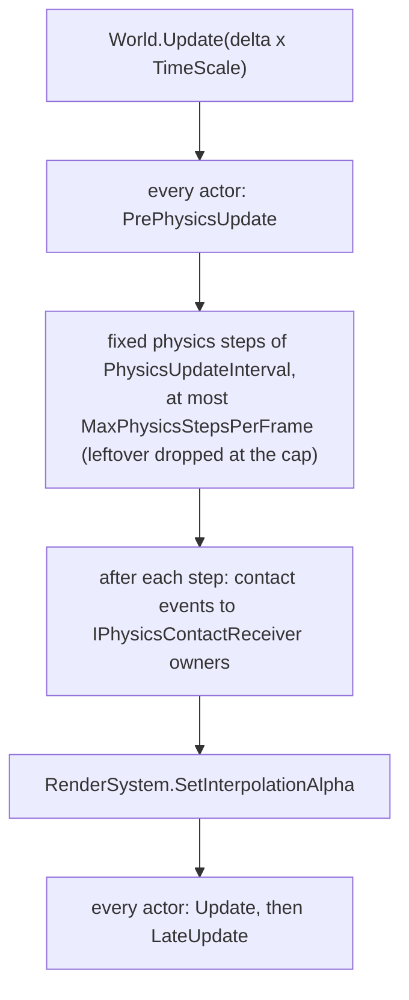

# Rin.World

The scene layer on top of [Rin.Core](../Rin.Core/ReadMe.md): a `World` owns actors, each actor owns components, and the world drives a fixed-step physics simulation on BepuPhysics and the default deferred render pipeline. `Viewport` shows a world inside a Rin.Core surface.

```
dotnet build Engine/Rin.World/Rin.World.csproj
dotnet test Engine/Rin.World.Tests/Rin.World.Tests.csproj -p:RinShadeSkipCompile=true
```

Without `RinShadeSkipCompile=true` the build also compiles the shaders and needs the real Slang native package. The tests live in [Rin.World.Tests](../Rin.World.Tests/ReadMe.md).

## Actors and components

There is no ECS. An actor is a bag of components keyed by type with an optional root `WorldComponent`, and transform calls on the actor forward to that root. A component overrides `Start`, `Stop`, `PrePhysicsUpdate`, `Update` and `LateUpdate`.

| Component | What it does |
| --- | --- |
| `StaticMeshComponent`, `SkinnedMeshComponent` | Draw a mesh with one `IMeshMaterial` per surface. The skinned one takes its pose from an `IPoseSource` such as `AnimationGraph`. |
| `CameraComponent` | The view a `Viewport` renders from. |
| `PointLightComponent`, `DirectionalLightComponent` | Lights, pushed to the renderer as `LightInfo`. |
| `BoxPhysicsComponent`, `SpherePhysicsComponent`, `CapsulePhysicsComponent` | One Bepu body each. `PhysicsState` picks who drives the transform: `Static` is placed once, `Controlled` pushes the component transform into the body, `Simulated` reads it back. `IsTrigger` makes the body an overlap volume. |

## The update step



Physics queries (ray and shape casts, overlaps) take a `ref struct` handler or a `Span` buffer, so a query never allocates.

## From components to the GPU

Components never touch GPU state. They create, update and destroy proxies on `IRenderSystem`, and `DefaultRenderSystem` queues every change until the next `Snapshot`.


The snapshot blends each proxy's previous and current transform by the interpolation alpha, so fixed-step physics renders smoothly. Mesh components push a transform only when their `TransformVersion` changed.

## The default render pipeline

`DefaultWorldViewData.Write` adds the passes. The scene half is shared by every view of the same snapshot in a graph (`GetOrAddShared`), the view half runs once per camera. On a device without indirect rendering, or with `DefaultRenderSystem.DrawMode` set to `Direct`, the culling and command passes are skipped and the depth and G-buffer passes draw each mesh from the CPU instead.

| Pass | Scope | Reads | Writes |
| --- | --- | --- | --- |
| `InitSceneResourcesPass` | scene | | bounds buffer, one `Bounds3D` per surface |
| `SkinningPass` (only with skinned meshes) | scene | source vertices, pose matrices | one shared skinned vertex buffer |
| `BoundsUpdatePass` (only with skinned meshes) | scene | skinned vertices | the skinned entries of the bounds buffer |
| `SceneDataPass` | scene | processed meshes and materials | material data and `IndirectMeshRecord` buffers per batch |
| `InitViewResourcesPass` | view | | GBuffer0..3 (`RGBA32`) and the depth image |
| `CullingPass` | view, indirect only | bounds buffer | one `uint` per surface (always 1 today, nothing is culled yet) |
| `FillIndirectBuffersPass` | view, indirect only | culling results, mesh records | `DrawIndexedIndirectCommand` and draw count buffers per batch |
| `DepthPrepassIndirectPass` or `DepthPrepassDirectPass` | view | indirect commands, depth material data, skinned vertices | depth image |
| `FillGBufferIndirectPass` or `FillGBufferDirectPass` | view | depth image, color material data, textures, skinned vertices | GBuffer0..3 |
| `LightingPass` | view | GBuffer0..3, the light array | the output image (`RGBA16`) |

Meshes are batched by index buffer plus material, so each batch is one `DrawIndexedIndirectCount`. `ShadowPass` exists but is not implemented and nothing adds it.

## Showing a world

`Viewport` (a Rin.Core `ContentView`) takes a `CameraComponent`, snapshots the render system in `CollectContent`, and `ViewportCommandHandler` writes the pipeline above into the graph and draws the result with `ViewportShader`. A primary click cycles the `ViewportChannel` (scene, each G-buffer channel, radiance), a secondary click captures the mouse for `OnMouseDelta`. The render size follows the content size only after it has been stable for `Viewport.SettleFrames` frames, so a resize stretches the last render instead of reallocating the G-buffers every frame.

The examples build `new World(new DefaultRenderSystem(), new BepuPhysicsSystem())`, call `Start()` and give a camera actor a `Viewport`.

References: Rin.Core, Rin.Shade (plus its source generator), Rin.SourceGenerators. Packages: BepuPhysics. Referenced by Rin.GLTF, Examples and Rin.World.Tests.
