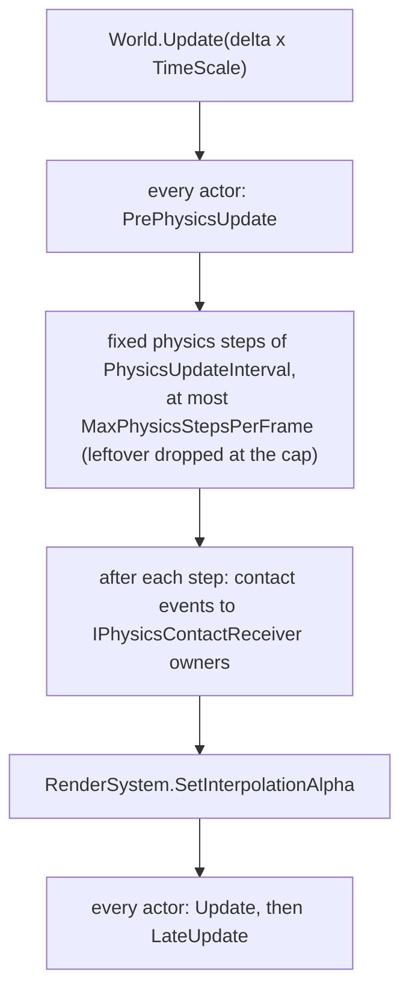
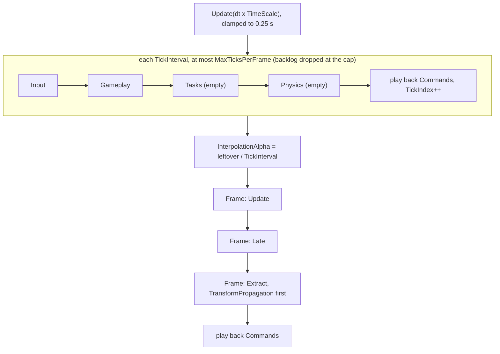
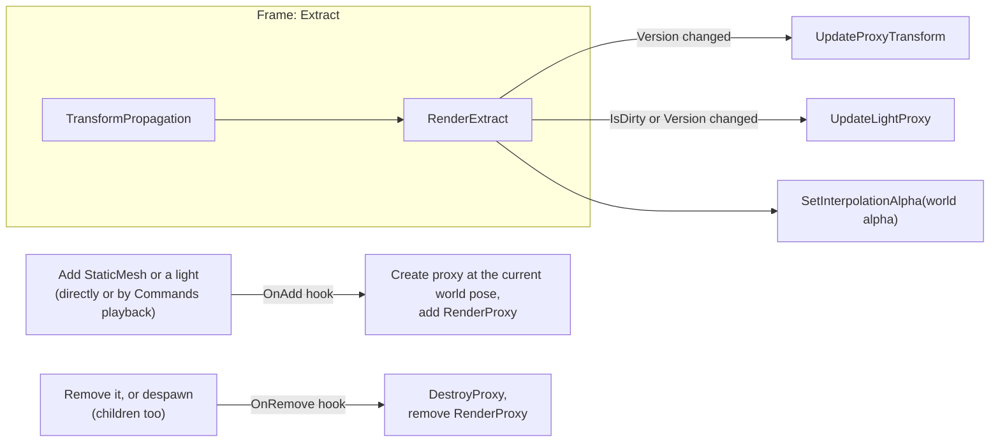

# Rin.World

The scene layer on top of [Rin.Core](../Rin.Core/ReadMe.md): a `World` owns actors, each actor owns components, and the world drives a fixed-step physics simulation on BepuPhysics and the default deferred render pipeline. `Viewport` shows a world inside a Rin.Core surface.

```
dotnet build Engine/Rin.World/Rin.World.csproj
dotnet test Engine/Rin.World.Tests/Rin.World.Tests.csproj -p:RinShadeSkipCompile=true
```

Without `RinShadeSkipCompile=true` the build also compiles the shaders and needs the real Slang native package. The tests live in [Rin.World.Tests](../Rin.World.Tests/ReadMe.md).

## Actors and components

This is the scene model `SceneTest` and the headless example use. The [ECS](#ecs-in-progress) below is replacing it (`Sponza` and `AssetViewer` already run on it) and both exist until the migration finishes. An actor is a bag of components keyed by type with an optional root `WorldComponent`, and transform calls on the actor forward to that root. A component overrides `Start`, `Stop`, `PrePhysicsUpdate`, `Update` and `LateUpdate`.

| Component | What it does |
| --- | --- |
| `StaticMeshComponent`, `SkinnedMeshComponent` | Draw a mesh with one `IMeshMaterial` per surface. The skinned one takes its pose from an `IPoseSource` such as `AnimationGraph`. |
| `CameraComponent` | The view a `Viewport` renders from. |
| `PointLightComponent`, `DirectionalLightComponent` | Lights, pushed to the renderer as `LightInfo`. |
| `BoxPhysicsComponent`, `SpherePhysicsComponent`, `CapsulePhysicsComponent` | One Bepu body each. `PhysicsState` picks who drives the transform: `Static` is placed once, `Controlled` pushes the component transform into the body, `Simulated` reads it back. `IsTrigger` makes the body an overlap volume. |

## The update step



Physics queries (ray and shape casts, overlaps) take a `ref struct` handler or a `Span` buffer, so a query never allocates.

## ECS (in progress)

`EntityWorld` is an archetype ECS that will replace actors and components. It runs on [Friflo.Engine.ECS](https://github.com/friflo/Friflo.Engine.ECS), but only `Ecs/Backend/` may reference Friflo: `BannedSymbols.txt` bans the namespace and `.editorconfig` turns the ban into a build error everywhere else in this project. Gameplay code sees only Rin types.

| Piece | What it is |
| --- | --- |
| `Entity` | An id plus generation handle. A despawned entity's handle stops matching when the id is reused. |
| `IComponentData`, `ITagData` | Markers for component and tag structs. |
| `Query<T1>` to `Query<T1, T2, T3, T4>` | `foreach (var chunk in query)` gives one `Span<T>` per component and the chunk's entities, without allocating. Structural changes inside the loop throw, so record them in a `CommandBuffer`. |
| `CommandBuffer` | Records spawn, despawn, add, set, remove and tag changes, and applies them in record order. Spawn creates the entity at once so ids follow record order. Commands for an entity that is gone by playback are skipped. |
| Hierarchy | `SetParent`, `ClearParent`, `GetParent`, `GetChildren`. Despawning an entity despawns its descendants, depth first. Reparenting marks the child dirty. |
| Hooks | `OnAdd<T>` fires when a component is new, `OnRemove<T>` fires before it is removed, also on despawn. |
| Transforms | `LocalTransform` and `WorldTransform` (matrix plus `Version`). Every `LocalTransform` setter sets its `IsDirty` flag, so a write through a query span needs no structural change. `SetPosition`, `SetRotation`, `SetScale` and `SetLocalTransform` add both components when missing. |

`EntityWorld.Update(dt)` runs fixed ticks of `TickInterval` (1/60 s by default) from the time-scaled delta, then the frame phases. Systems run in the order they were added to their phase.



`TransformPropagation` walks each hierarchy depth first from its roots. It recomputes `world = local x parentWorld` (row vectors, like `WorldComponent`) for dirty entities and for children of a parent whose matrix changed, clears `IsDirty`, and bumps `Version` only when the matrix changed. It reaches a subtree only through parents that have both transform components.

### Rendering entities

`new RenderFeature(entityWorld, renderSystem, meshFactory)` connects an `EntityWorld` to an `IRenderSystem`. Components hold only unmanaged data: a mesh is its `IMeshFactory` id, and its materials are a `MaterialSet` handle from `RenderFeature.Materials`.

| Component | What it does |
| --- | --- |
| `StaticMesh` | Mesh id plus `MaterialSet`. Surface `i` uses material `i`, a missing one reuses the previous surface's material, an empty set draws the default material. A mesh that is not ready when the component is added gets no proxy. |
| `PointLight`, `DirectionalLight` | Color, radiance and radius. Every setter sets `IsDirty`, like `LocalTransform`. The directional light shines along the entity's world forward axis. |
| `Camera` | Field of view and clip planes. `world.GetCameraView(entity)` combines it with `WorldTransform` into a `CameraView`. |
| `RenderProxy` | Added by the feature: the proxy handle and the `WorldTransform.Version` last pushed. |

An entity holds at most one of `StaticMesh`, `PointLight` and `DirectionalLight` (a second one throws), so use child entities for more.



The proxy starts at the world pose computed from the local transforms, not the stored `WorldTransform`, which is stale until propagation runs. An entity without transforms gets an identity proxy. `RenderExtract` does not allocate.

## From components to the GPU

Components never touch GPU state. They create, update and destroy proxies on `IRenderSystem`, and `DefaultRenderSystem` queues every change until the next `Snapshot`.


The snapshot blends each proxy's previous and current transform by the interpolation alpha, so fixed-step physics renders smoothly. Mesh components push a transform only when their `TransformVersion` changed. ECS entities feed the same proxies through `RenderFeature` (see [Rendering entities](#rendering-entities)).

## The default render pipeline

`DefaultWorldViewData.Write` adds the passes. The scene half is shared by every view of the same snapshot in a graph (`GetOrAddShared`), the view half runs once per camera. On a device without indirect rendering, or with `DefaultRenderSystem.DrawMode` set to `Direct`, the culling and command passes are skipped and the depth and G-buffer passes draw each mesh from the CPU instead.

| Pass | Scope | Reads | Writes |
| --- | --- | --- | --- |
| `InitSceneResourcesPass` | scene | | bounds buffer, one `Bounds3D` per surface |
| `SkinningPass` (only with skinned meshes) | scene | source vertices, pose matrices | one shared skinned vertex buffer |
| `BoundsUpdatePass` (only with skinned meshes) | scene | skinned vertices | the skinned entries of the bounds buffer |
| `SceneDataPass` | scene | processed meshes and materials | material data and `IndirectMeshRecord` buffers per batch |
| `InitViewResourcesPass` | view | | GBuffer0..3 (`RGBA32`) and the depth image |
| `CullingPass` | view, indirect only | bounds buffer | one `uint` per surface (always 1 today, nothing is culled yet) |
| `FillIndirectBuffersPass` | view, indirect only | culling results, mesh records | `DrawIndexedIndirectCommand` and draw count buffers per batch |
| `DepthPrepassIndirectPass` or `DepthPrepassDirectPass` | view | indirect commands, depth material data, skinned vertices | depth image |
| `FillGBufferIndirectPass` or `FillGBufferDirectPass` | view | depth image, color material data, textures, skinned vertices | GBuffer0..3 |
| `LightingPass` | view | GBuffer0..3, the light array | the output image (`RGBA16`) |

Meshes are batched by index buffer plus material, so each batch is one `DrawIndexedIndirectCount`. `ShadowPass` exists but is not implemented and nothing adds it.

## Showing a world

`Viewport` (a Rin.Core `ContentView`) takes a `CameraComponent`, or a `RenderFeature` and a camera entity. It builds a `CameraView` (world matrix plus projection parameters), snapshots the render system with it in `CollectContent`, and `ViewportCommandHandler` writes the pipeline above into the graph and draws the result with `ViewportShader`. A primary click cycles the `ViewportChannel` (scene, each G-buffer channel, radiance), a secondary click captures the mouse for `OnMouseDelta`. The render size follows the content size only after it has been stable for `Viewport.SettleFrames` frames, so a resize stretches the last render instead of reallocating the G-buffers every frame.

`SceneTest` builds `new World(new DefaultRenderSystem(), new BepuPhysicsSystem())`, calls `Start()` and gives a camera actor a `Viewport`. `Sponza` and `AssetViewer` build an `EntityWorld` with a `RenderFeature` and give a camera entity a `Viewport`.

References: Rin.Core, Rin.Shade (plus its source generator), Rin.SourceGenerators. Packages: BepuPhysics, Friflo.Engine.ECS, Microsoft.CodeAnalysis.BannedApiAnalyzers (build only). Referenced by Rin.GLTF, Examples and Rin.World.Tests.
