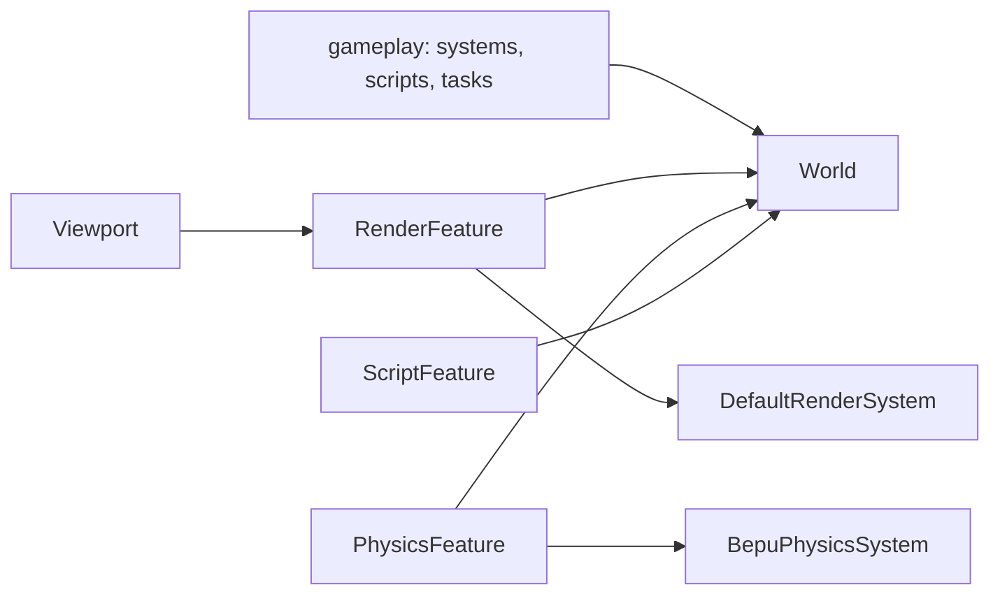

# Rin.World

The scene layer on top of [Rin.Core](../Rin.Core/ReadMe.md): an archetype ECS (`World`) with a fixed tick, plus features that connect it to rendering, physics and scripts.

```
dotnet build Engine/Rin.World/Rin.World.csproj
dotnet test Engine/Rin.World.Tests/Rin.World.Tests.csproj -p:RinShadeSkipCompile=true
```

Without `RinShadeSkipCompile=true` the build also compiles shaders and needs the real Slang native package.



The ECS runs on Friflo.Engine.ECS, but only `Ecs/` may reference it (a banned-API build error elsewhere), so gameplay code sees only Rin types.

**NativeAOT:** a project that declares components references [Rin.SourceGenerators](../Rin.SourceGenerators/ReadMe.md) as an analyzer, which registers them at startup. Generic or private components get warning `RIN00024` and need `ComponentRegistry.RegisterComponent<T>()` by hand.

## Entities and the update step

| Piece | What it is |
| --- | --- |
| `Entity` | Id plus generation, stale after despawn |
| `Query<T1..T4>` | `foreach` gives one `Span<T>` per component. Structural changes inside the loop throw, so use `world.Commands` |
| Hierarchy | `SetParent` and friends. Despawn removes descendants too |
| Hooks | `OnAdd<T>`, `OnRemove<T>`. Features create and destroy proxies and bodies from them |
| Transforms | `LocalTransform` (setters mark it dirty) and `WorldTransform`, propagated once per frame |

`World.Update(dt)` runs fixed ticks (1/60 s by default), then the frame phases:


## Scripts and tasks

`new ScriptFeature(world)`, then `scripts.Attach(entity, script)`. A `Script` has `Start`, `Tick`, `Stop` and `Restore`, one per entity. `GameTask` methods are `async` on the tick, not the thread pool. From SceneTest:

```csharp
public sealed class BoxRain(float intervalSeconds, Action dropBox) : Script
{
    protected override void Start() => Tasks.Run(Rain);

    protected override void Restore() => Tasks.Run(Rain);

    private async GameTask Rain(TaskContext ctx)
    {
        while (true)
        {
            await ctx.Seconds(intervalSeconds);
            dropBox();
        }
    }
}
```

- `TaskContext` also has `Ticks`, `NextTick`, `Until`, `Event<T>`, `WhenAny` and `WhenAll`.
- A cancel throws `GameTaskCanceledException` at the pending `await`, so `catch` and `finally` run. `CancelReason` says why.
- Awaiting a regular `Task` faults the task.
- Only components survive a snapshot restore. `Restore` restarts tasks from them.

The `scripting` example has one small script per pattern (patrol, sequenced door, fuse and defuse, cancellation).

## Rendering

`new RenderFeature(world, renderSystem, meshFactory)`. Components hold only ids and handles.

| Component | What it does |
| --- | --- |
| `StaticMesh`, `SkinnedMesh` | Mesh id plus a `MaterialSet` from `RenderFeature.Materials`. Skinned meshes also need a pose source |
| `PointLight`, `DirectionalLight` | Color, radiance, radius |
| `Camera` | `world.GetCameraView(entity)` for a `Viewport` |

One mesh or light per entity, so use child entities for more. Animation runs per frame. `renderFeature.AttachToBone(child, parent, "bone")` makes a child follow a bone, with its `LocalTransform` as the offset from the bone. Call it again to move it to another bone, and `DetachFromBone` to stop.

### Materials

A material is a struct whose fields are its parameters, with a static `Evaluate` that returns the `Surface` at a pixel. Its shader is one line, and `SurfaceMaterial<T>` draws it. From the engine and SceneTest:

```csharp
[Shader]
public partial class PbrShader : SurfaceShader<PbrMaterial>;

return new SurfaceMaterial<PbrMaterial>(new PbrMaterial
{
    BaseColorTexture = albedo.Result,
    RoughnessTexture = roughness.Result,
    MetallicTexture = metallic.Result
});
```

- Fields: scalars, vectors, matrices, fixed-size arrays and `DeviceHandle` textures. Report textures from `GetTextures`.
- To move vertices, override `ProcessVertex`, set `MaxVertexOffset`, and return a `SurfaceDepthShader<T>` from `DepthShader`, or the depth prepass won't match. `Examples/Examples/SceneTest/WavyMaterial.cs` is a complete one.
- Anything that needs its own passes implements `IMeshMaterial` directly.

## Physics

`new PhysicsFeature(world, physicsSystem)`, then add a `RigidBody` (shape, `PhysicsState`, mass, trigger) and optionally `Velocity`.

| `PhysicsState` | Behaviour |
| --- | --- |
| `Static` | Never moves |
| `Controlled` | Follows the entity's transform every tick |
| `Simulated` | Bepu moves it and writes the pose back to `LocalTransform` |

`RigidBody` is read once, so remove and re-add it to change the shape. `PhysicsFeature.Contacts` holds the last tick's contacts. Casts and overlaps return entities.

## Determinism and snapshots

The tick is deterministic on the same build and CPU family. Tick code must:

- use `TickContext.DeltaSeconds`, never the frame delta
- never iterate a `Dictionary` or `HashSet`
- spawn and despawn through `Commands`
- draw random numbers from `world.Random`
- keep components unmanaged (managed data goes in a registry, and the component holds an id)

`world.SaveSnapshot(snapshot)` and `RestoreSnapshot(snapshot)` rewind the world, and `snapshot.ComputeHash()` compares worlds. Render proxies, physics bodies and scripts are rebuilt after a restore. Running tasks and pending commands are dropped. Bepu's internal state is not restored, so a restored physics run only matches another run that restored at the same ticks.

## The render pipeline

`DefaultRenderSystem` queues proxy changes and rebuilds its snapshot when something changed. Each camera then adds these passes:


The light grid sorts point lights by view depth into 1024 depth bins on the CPU (`LightBinner`), then a compute pass marks which lights touch each 32 x 32 pixel tile. Lighting only loops the lights in both a pixel's tile and its depth bin, plus every directional light. A light reaches nothing past its `Radius`.

Draws are batched by index buffer plus material pass, and materials that don't move vertices share one depth pass. Without indirect rendering (or with `DrawMode = Direct`), culling is skipped and meshes draw from the CPU. Culling doesn't cull anything yet.

`Viewport` shows a world in a Rin.Core surface. A click cycles the debug channel (scene, G-buffer channels, radiance).

References: Rin.Core, Rin.Shade, Rin.SourceGenerators. Packages: BepuPhysics, Friflo.Engine.ECS.
