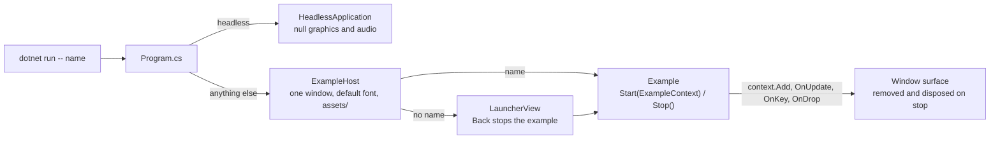

# Examples

All the example apps in one executable. Each example is a folder with a class deriving from `Example`, listed in `ExampleRegistry`.

```
dotnet run --project Examples/Examples/Examples.csproj
dotnet run --project Examples/Examples/Examples.csproj -- sponza
```

With no argument a launcher window lists the examples and Back returns to it. With a name as the first argument that example starts directly in its own window. `--log-file <path>` redirects the log to a file.

| Name | Folder | What it is | Controls |
| --- | --- | --- | --- |
| `ui-gallery` | `UiGallery/` | A gallery of the UI rendering features: every quad mode, blur and clipping. | Drag to scroll. |
| `paint` | `Paint/` | A canvas to draw on with swatches and a brush size slider. | Left drag paints, right drag erases, Undo or Ctrl+Z, Clear. |
| `video-player` | `VideoPlayer/` | A webm video from a picked file or a typed URL, or one given after the example name. | Play and pause on the bar, click the video to toggle, right click to seek. |
| `audio-effects` | `AudioEffects/` | A picked audio file played through switchable effects, applied in the order switched on. | Seek bar, one on/off row per effect, steppers and presets for parameters. |
| `image-strip` | `ImageStrip/` | A row of tiles that widen while hovered: images, a custom Shade shader, a color wheel. | Add images (or drop files), Add shader, Add color wheel. |
| `stencil-clip` | `StencilClip/` | Three spinning clipped panels, one nested inside another. | None. |
| `windows` | `ChildWindows/` | Child windows and fullscreen, with a count of open child windows. Each child gets the same controls and can open its own. Children close when the example stops. | Open window, Fullscreen or Alt+Enter, F switches the module between 2 and 3 frames in flight. |
| `text-input` | `TextInput/` | A single line and a multi line field with a readout of the caret, the composition and the code units. | Click a field and type, Escape drops focus. |
| `audio-player` | `AudioPlayer/` | A music player: queue, albums, cover art, a blurred backdrop, a six band equalizer and a spectrum visualizer around the cover with several looks. | Plus button, drop files or pass paths. Space plays and pauses, Left and Right skip, `V` cycles the visualizer. |
| `scene-test` | `SceneTest/` | A 3D world with physics in a dockable layout with a perspective and a top camera. | W, A, S, D move, P drops a grid of boxes, a button opens the render graph overlay. |
| `sponza` | `Sponza/` | `assets/models/sponza.glb` with a custom Shade mesh material and an FPS counter. | W, A, S, D and the mouse move the camera while the viewport is focused. |
| `asset-viewer` | `AssetViewer/` | The skinned fox model looping its run animation. | None. |
| `render-graph` | `RenderGraphViewer/` | A small scene with the render graph overlay open. | Capture snapshots a frame. |
| `headless` | `HeadlessTest/` | The engine with no window and no GPU: drops a sphere in a physics world, prints its height and exits. | None. |

## How it fits together



The UI examples share the palette, cards, buttons, inputs and sliders in `Common/Views/`. To add an example, add a folder with an `Example` subclass and add it to `ExampleRegistry.All`.

## The render graph overlay

`RenderGraphOverlay/` draws the render graph of a captured frame over any window, with pan, zoom and a details panel per pass. Add it after an example's own content so it draws on top:

```csharp
context.Add(myContent);
context.Add(GraphOverlay.Create(context.Surface));
```

The layout code under `Layout/` has no UI types and is covered by [Examples.Tests](../Examples.Tests/ReadMe.md).

References: Examples.Common, Rin.Core, Rin.World, Rin.GLTF, Rin.Graphics.Null, Rin.Audio.Null, Rin.Shade (plus its source generator), Rin.SourceGenerators, experiments.Docking. Packages: z440.atl.core, SharpGLTF.Core.
