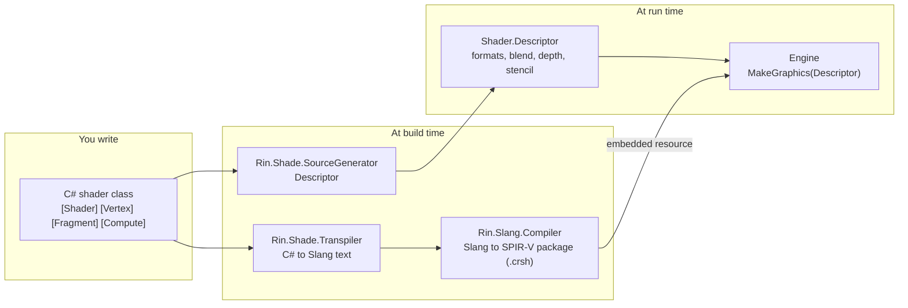
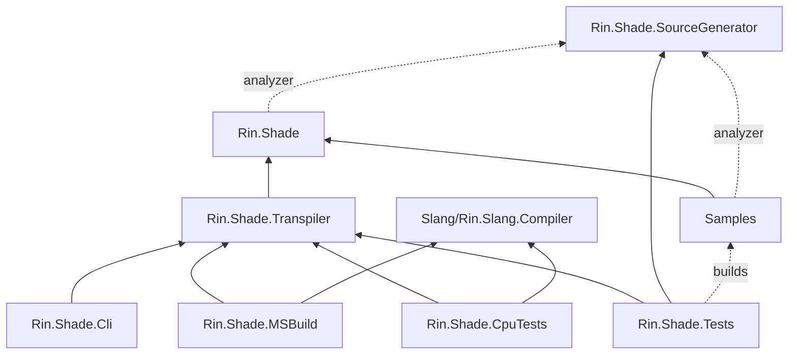

# Shade

Shaders for Rin are C# classes. At build time a Roslyn transpiler turns each `[Shader]` class into Slang, the Slang toolchain (`Slang/`) compiles that to a `.crsh` package, and the package is embedded in the assembly under the class's full name. A source generator adds a typed `Descriptor` to the same class, so the engine reads the pipeline state (attachment formats, blend, depth, stencil, thread-group size) from the C# attributes instead of recovering it from the compiled shader.



| Project | What it is |
| --- | --- |
| [Rin.Shade](Rin.Shade/ReadMe.md) | The authoring API: `Shader` base class, attributes, intrinsics, `BufferRef<T>`, descriptors. |
| [Rin.Shade.Transpiler](Rin.Shade.Transpiler/ReadMe.md) | The Roslyn transpiler from C# shader classes to Slang text. |
| [Rin.Shade.SourceGenerator](Rin.Shade.SourceGenerator/ReadMe.md) | Source generators: the `Descriptor` and the exported shader source. |
| [Rin.Shade.MSBuild](Rin.Shade.MSBuild/ReadMe.md) | The `CompileRinShadeShaders` task behind `msbuild/RinShade.targets`. |
| [Rin.Shade.Cli](Rin.Shade.Cli/ReadMe.md) | `rin-shade compile`, the transpiler from the command line. |
| [Rin.Shade.Tests](Rin.Shade.Tests/ReadMe.md) | Snapshot and unit tests for the transpiler and generators, no native Slang needed. |
| [Rin.Shade.CpuTests](Rin.Shade.CpuTests/ReadMe.md) | Runs transpiled shaders on the CPU through the real Slang. |
| [Samples](Samples/ReadMe.md) | Three chained assemblies for the cross-assembly tests. |



Solid arrows are project references. Dotted arrows are an analyzer reference (the project runs the generator on its own compile) or a build-order-only reference. An engine project with shaders (`Rin.Core`, `Rin.World`, `Examples`) imports `msbuild/RinShade.targets` and references the generator as an analyzer.

## Writing a shader

A shader derives from `Shader`, marks its entry points, and takes and returns structs whose fields carry the semantics. This is `Rin.Shade.Tests/Fixtures/GraphicsTriangleFixtureShader.cs`, and below it the Slang that `dotnet run --project Shade/Rin.Shade.Cli -- compile Shade/Rin.Shade.Tests/Fixtures/GraphicsTriangleFixtureShader.cs -o out/triangle.slang` wrote for its fragment stage. Names become lowerCamelCase and C# namespaces become Slang namespaces.

```csharp
[Shader]
public class GraphicsTriangleFixtureShader : Shader
{
    [Push] protected GraphicsPushConstants Push;
    [Vertex]
    public virtual VsOut Vertex(VsIn input) { ... }
    [Fragment, Attachment(AttachmentFormat.RGBA16), Stencil]
    public virtual Vector4 Fragment(FsIn input) => Push.Color;
}
```

```slang
[[vk::push_constant]] uniform ConstantBuffer<GraphicsPushConstants, ScalarDataLayout> push;
[shader("fragment")]
float4 fragment(FsIn input)
{
    return push.color;
}
```

The C# the transpiler accepts:

| Area | Supported | Rejected |
| --- | --- | --- |
| Types | `float`, `int`, `uint`, `Vector2` to `Vector4`, `Matrix4x4`, `BufferRef<T>` (a pointer), `Texture2D`, `Texture2DArray`, `TextureCube`, `SamplerState`, structs, nested types, enums, `[InlineArray]` structs as fixed arrays, explicit-layout structs as unions | `double` (SHADE0021), enums with a non-`int` base, writes through a union variant |
| Control flow | `if`, ternary, `for`, `while`, `foreach` over an inline array, `switch` with constant cases, switch expressions with constant, relational, `and`, `or`, `not` and discard patterns, local functions | pattern `case` clauses, recursion |
| Structs | fields, auto properties, properties with bodies, `record struct`, `with`, instance and static methods, generic structs (one Slang struct per instantiation) | open generic types |
| Functions | helpers in any static class, `out` and named arguments, generic methods (one function per instantiation), extension members (C# 14 blocks and `this` methods), virtual and abstract overrides flattened through the base chain, generic base classes | |
| Constants | `const` (inlined), `static readonly` with a constant initializer (a Slang `static const`) | |
| Builtins | the static math on `Shader` (`Lerp`, `Max`, ...), swizzles (`v.XY`), `[SlangExpression]` and `[SlangStatement]` bindings, `Interlocked*` atomics and the `*MemoryBarrier*` intrinsics, `[GroupShared]` static fields | |

Anything else is a build error, and a Slang error is reported against the C# line it was lowered from. Rules that hold everywhere:

| Rule | Where it comes from |
| --- | --- |
| Every block is scalar layout, matching C# sequential layout. | `ScalarDataLayout` on push constants and `forceGLSLScalarBufferLayout` in `native/Rin.Slang.Native/src/slang.cpp`. |
| Matrices are row-major with row-vector math (`v * M`), the same as `System.Numerics`. | `SLANG_MATRIX_LAYOUT_ROW_MAJOR` in the native session, pinned by `Rin.Shade.CpuTests`. |
| Resources are bindless. | `[BindlessBlock(name)]` on a `[BindingGroup]` type resolves to an engine-owned descriptor set (`BindlessData` in Rin.Core). |
| A shader is embedded as `<full class name>.crsh` and its `Descriptor` opens it from its own assembly. | `CompileRinShadeShaders` sets the resource name, `IShaderDescriptor.Open` reads it. |
| A `[Shader]` class is `partial` and top-level. | SHADEGEN0001 and SHADEGEN0002 from the generator. |

| Build flag (a `-p:` property) | Effect |
| --- | --- |
| `RinShadeSkipCompile=true` | Skips shader compilation. CI passes it to every test job but `Rin.Shade.Tests`. |
| `RinShadeDumpGenerated=true` | Also writes the emitted Slang to `GeneratedShaders/` under the output directory (`RinShadeGeneratedDirectory` overrides the folder). |
| `RinShadeMaxParallelism=N` | Compiles up to N shaders at once. Unset, one worker thread per 64 stale shaders, capped at the processor count. |
