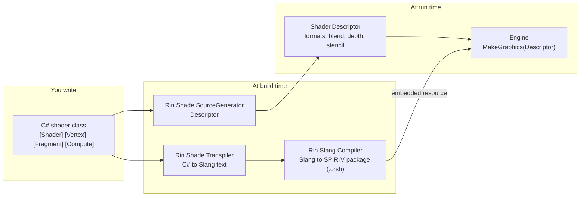

# Shade

Shaders for Rin are C# classes. At build time each `[Shader]` class is transpiled to Slang, compiled to SPIR-V, and embedded in the assembly. A generated `Descriptor` carries the pipeline state (formats, blend, depth, stencil) from the C# attributes.



| Project | What it is |
| --- | --- |
| [Rin.Shade](Rin.Shade/ReadMe.md) | The authoring API: `Shader` base class, attributes, intrinsics, resource types, descriptors. |
| [Rin.Shade.Transpiler](Rin.Shade.Transpiler/ReadMe.md) | The Roslyn transpiler from C# shader classes to Slang text. |
| [Rin.Shade.SourceGenerator](Rin.Shade.SourceGenerator/ReadMe.md) | Source generators: the `Descriptor` and the exported shader source. |
| [Rin.Shade.MSBuild](Rin.Shade.MSBuild/ReadMe.md) | The `CompileRinShadeShaders` task behind `msbuild/RinShade.targets`. |
| [Rin.Shade.Cli](Rin.Shade.Cli/ReadMe.md) | `rin-shade compile`, the transpiler from the command line. |
| [Rin.Shade.Tests](Rin.Shade.Tests/ReadMe.md) | Snapshot and unit tests for the transpiler and generators, no native Slang needed. |
| [Rin.Shade.CpuTests](Rin.Shade.CpuTests/ReadMe.md) | Runs transpiled shaders on the CPU through the real Slang. |
| [Samples](Samples/ReadMe.md) | Three chained assemblies for the cross-assembly tests. |

## Writing a shader

A shader derives from `Shader` and marks its entry points. From `Rin.Shade.Tests/Fixtures/GraphicsTriangleFixtureShader.cs`, with the Slang `rin-shade compile` wrote for its fragment stage:

```csharp
[Shader]
public class GraphicsTriangleFixtureShader : Shader
{
    [Push] protected GraphicsPushConstants Push;
    [Vertex]
    public virtual VsOut Vertex(VsIn input) { ... }
    [Fragment, Attachment(AttachmentFormat.RGBA16), Stencil]
    public virtual Vector4 Fragment(FsIn input) => Push.Color;
}
```

```slang
[[vk::push_constant]] uniform ConstantBuffer<GraphicsPushConstants, ScalarDataLayout> push;
[shader("fragment")]
float4 fragment(FsIn input)
{
    return push.color;
}
```

## What the transpiler accepts

| Area | Supported |
| --- | --- |
| Types | `float`, `int`, `uint`, vectors, `Matrix4x4`, textures, samplers and `RWByteAddressBuffer`, structs, enums, inline arrays, explicit-layout unions |
| Code | `if`, loops, `switch` with constant cases and simple patterns, local functions, `with`, properties and indexers, `const`, `Unsafe.SizeOf<T>()` |
| Generics | Generic structs, methods and base classes (one Slang copy per instantiation), interface calls through a constrained type parameter |
| Builtins | Math on `Shader` (`Lerp`, `Max`, ...), swizzles, atomics, barriers, `[GroupShared]` |

Not supported: `double`, recursion, open generics, calls through an interface-typed value. Anything unsupported is a build error on the C# line.

- Buffers use scalar layout, matching C# sequential structs.
- Matrices are row-major with `v * M`, like `System.Numerics`.
- Resources are bindless. Shaders read the static members of `BindlessData` in Rin.Core, and buffers through `DeviceSpan<T>`.
- A `[Shader]` class must be `partial` and top-level.
- To use a base shader or helper from another assembly, mark it `[ShadeExport]`.

| Build flag | Effect |
| --- | --- |
| `-p:RinShadeSkipCompile=true` | Skip shader compilation |
| `-p:RinShadeDumpGenerated=true` | Also write the emitted Slang to `GeneratedShaders/` |
