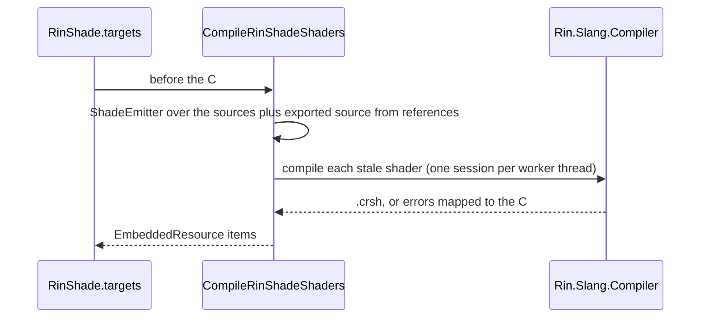

# Rin.Shade.MSBuild

The `CompileRinShadeShaders` task behind `msbuild/RinShade.targets`. It transpiles every `[Shader]` class in the project, compiles the Slang with `Rin.Slang.Compiler`, and returns the `.crsh` packages as `EmbeddedResource` items named `<full class name>.crsh`. A project imports the targets file and nothing else (`Engine/Rin.Core/Rin.Core.csproj`).

| Property | Effect |
| --- | --- |
| `RinShadeSkipCompile=true` | Skips the step, and the task build with it. |
| `RinShadeDumpGenerated=true` | Also writes the Slang to `GeneratedShaders/<full class name>.slang` under the output directory (`RinShadeGeneratedDirectory` overrides the folder). |
| `RinShadeMaxParallelism=N` | Compiles up to N shaders at once. Unset or `0`: one thread per 64 stale shaders, capped at the processor count. |

A shader whose `.crsh` under `obj` still carries the hash of its current Slang (`ShaderCompiler.IsUpToDate`) is reused, and when nothing is stale no Slang session is created. The task runs in a short-lived task host (`TaskHostFactory`), so its DLLs are never left locked.

Gotcha: the on-demand build of this project does not restore, so restore the solution first on a clean checkout.

References: Rin.Shade.Transpiler, Slang/Rin.Slang.Compiler. Packages: Microsoft.Build.Utilities.Core. No project references it; the targets file loads `bin/Release/net10.0/Rin.Shade.MSBuild.dll` with `UsingTask`.
