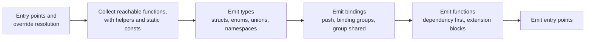

# Rin.Shade.Transpiler

The Roslyn transpiler from C# shader classes to Slang text. `ShadeEmitter.Emit(compilation)` returns the Slang, a source map (Slang line to C# location) and the diagnostics for every `[Shader]` class. Build-time tooling, so it favours clarity over allocation.

```
dotnet build Shade/Rin.Shade.Transpiler/Rin.Shade.Transpiler.csproj
dotnet test Shade/Rin.Shade.Tests/Rin.Shade.Tests.csproj
```

For one shader, `ShaderLowering` runs these steps in order:



- `Emit(compilation, localTrees)` only treats classes in `localTrees` as shaders. Trees that `ScratchCompilationBuilder` pulls in from referenced assemblies exist so their bodies can be walked.
- `Rin.Shade.MSBuild` is rebuilt before every shader compile, so a change here reaches the real build on the next build.

References: Rin.Shade. Packages: Microsoft.CodeAnalysis.CSharp, Microsoft.CodeAnalysis.CSharp.Workspaces. Used by Rin.Shade.MSBuild, Rin.Shade.Cli, Rin.Shade.Tests and Rin.Shade.CpuTests.
