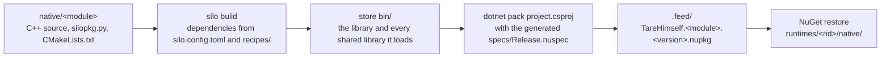

# native

C++ modules that reach managed code as NuGet packages, plus the C# fakes that stand in for them in tests. [silo](https://github.com/TareHimself/silo) and CMake build each module into one shared library, which is packed as `TareHimself.<module>` into the local feed `.feed/` (see `NuGet.Config`). The managed projects reference those packages as `1.*` in `Directory.Packages.props`.

| Module | Wraps | Used by |
| --- | --- | --- |
| [Rin.Native](Rin.Native/ReadMe.md) | Memory, platform, SDF (msdfgen) and video (webmdx) helpers | `Rin.Core` |
| [Rin.Audio.Miniaudio.Native](Rin.Audio.Miniaudio.Native/ReadMe.md) | miniaudio | `Rin.Audio.Miniaudio` |
| [Rin.Graphics.Vulkan.Native](Rin.Graphics.Vulkan.Native/ReadMe.md) | Vulkan, windowing (rwin) and the Vulkan memory allocator | `Rin.Graphics.Vulkan` |
| [Rin.Slang.Native](Rin.Slang.Native/ReadMe.md) | A prebuilt Slang release | `Rin.Slang.Compiler` |
| [Fakes](Fakes/ReadMe.md) | NativeAOT C# stand-ins for `Rin.Native` and `Rin.Slang.Native` | Tests that call native code |

## Building and packing

Run from the repo root. [uv](https://docs.astral.sh/uv/) provides Python and silo (pinned to one commit in `pyproject.toml`); you also need a C++ toolchain and git. Every C++ dependency is built into silo's store (`~/.silo`, or `SILO_HOME`). Dependencies are found by name through `silo.config.toml`, and `recipes/` holds the ones no registry has (`slang`, `vulkan-memory-allocator`).

```
uv run silo profile detect
uv run python scripts/pack_native.py
```

`silo profile detect` records this machine's compiler and is needed once. `pack_native.py` packs every module, or the ones named (`uv run python scripts/pack_native.py Rin.Slang.Native`); `--version` replaces the recipe's version and `--feed` the output folder. A failed build points to its logs in `native/<module>/build-report/logs`.



For a build to work on, `uv run silo sync native/<module>` builds the dependencies and writes `.silo/` with the `Rin-Debug` and `Rin-Release` CMake presets, and `uv run silo run -C native/<module> -- cmake --preset Rin-Debug` configures with silo's compiler and tools.

## The three ways a native library reaches managed code

| Kind | Built by | Used when |
| --- | --- | --- |
| Real package | `uv run python scripts/pack_native.py`, or CI's `build-native-slang` job (`Rin.Slang.Native` only, as version `1.0.1`) | Running the engine, compiling shaders, and the `test-real-slang` CI jobs |
| Stub package | `uv run python scripts/pack_native_stubs.py .feed`: one placeholder `stub.dll` per `*.Native` id in `Directory.Packages.props`, version `1.0.0` | Restoring and building without silo or a C++ toolchain, which is every CI `test` job |
| Fake | `uv run python scripts/publish_native_fakes.py win-x64`: NativeAOT builds of `Fakes/` exporting the same entry points | `Rin.GLTF.Tests` and `Rin.Slang.Compiler.Tests` load one through a DllImport resolver; never in the feed |

## Error codes

A native export that can fail reports it with a return code, never with an exception or a message. Each module has its own `int32` enum with `Ok = 0` in `src/result.hpp`, mirrored one to one on the managed side, and every such export runs its body through `guarded`, which turns a `ResultError`, a `std::bad_alloc` or any other exception into a code so nothing unwinds into managed code. Values come back through out parameters. The managed `Native` class keeps the raw imports private and exposes checked wrappers that throw with the export's name and the code.

| Module | Enum | Managed side throws |
| --- | --- | --- |
| `Rin.Native` | `CoreResult` | `NativeException` (`Rin.Core`) |
| `Rin.Audio.Miniaudio.Native` | `AudioResult` | `NativeException` (`Rin.Core`) |
| `Rin.Graphics.Vulkan.Native` | `GraphicsResult` | `NativeException` (`Rin.Core`) |
| `Rin.Slang.Native` | `SlangNativeResult` | `SlangNativeException` (`Rin.Slang.Compiler`, which does not reference `Rin.Core`) |

Getters, free and dispose exports stay as they are. `memoryAllocate` returns null instead of a code, as allocators do, and `Rin.Core` turns that into `OutOfMemoryException`. Shader problems in `Rin.Slang.Native` (`CompileFailed`, `EntryPointNotFound`, `CompositionFailed`, `LinkFailed`) are not exceptions on the managed side: the wrapper returns null and the diagnostics blob holds the compiler output, exactly as before.

## Gotchas

- A clean checkout does not restore until `.feed/` holds the native packages: pack real ones or stubs first.
- silo builds a snapshot of the module folder as it is on disk, uncommitted changes included, and the folder has to be inside the git repository.
- silo refuses a `silopkg.py` with CRLF line endings. `.gitattributes` keeps the repository on LF.
